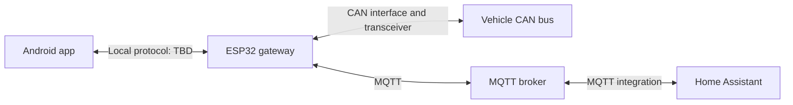

# eCMPilot

An independent, community-oriented Android app for monitoring and controlling supported Stellantis eCMP vehicles through an ESP32 CAN gateway installed in the vehicle.

The first target vehicle is an Opel Corsa-e. Support for other eCMP vehicles is a longer-term goal and will be verified per model and vehicle configuration.

**Status: planning.** This repository currently contains project documentation. The Android app, ESP32 firmware, communication protocol, and vehicle integration have not been implemented yet.

## Project goals

- Provide a local alternative to the vehicle functions offered by MyOpel, starting with the owner's Corsa-e.
- Read vehicle status and add supported control functions as the required CAN messages are understood and verified.
- Operate over a known local Wi-Fi network without requiring the manufacturer's cloud for the planned local connection.
- Support both an Android user interface and Home Assistant integration.
- Make the source available under BSD-2-Clause so anyone can build, modify, and redistribute the software, including commercially, under that license.
- Offer a paid Google Play build for convenient installation, updates, and support for development. A self-built version is intended to provide the same functionality without an app purchase.

## Planned architecture

The ESP32 is the vehicle gateway. It connects to the vehicle's CAN bus through suitable CAN interface hardware and joins a configured, known Wi-Fi network. The Android phone is on the same local network and communicates with the gateway. Home Assistant communicates through an MQTT broker reachable by the gateway.

The Android-to-gateway connection and MQTT connection use the local network. The MQTT broker may run on the Home Assistant host or another reachable machine. A broker is required for the planned MQTT integration; it is not intended to be required for direct Android access.

### Android application — this repository

- Discover or configure the gateway's local address and establish a connection.
- Display vehicle data, connection state, and data freshness.
- Send supported commands and display their outcomes, including failures and timeouts.
- Provide gateway connection settings and diagnostics.
- Keep vehicle-specific details behind an interface that can grow to support additional verified models.

The Android language, UI framework, minimum Android version, and application package name remain to be selected.

### ESP32 firmware — planned separate repository

- Connect to the selected CAN bus and translate verified vehicle messages into a documented data model.
- Expose that model and supported commands over the local application protocol.
- Publish vehicle state and accept supported commands through MQTT for Home Assistant.
- Join and reconnect to configured Wi-Fi networks.
- Report gateway health, supported capabilities, and protocol version.
- Handle vehicle sleep, wake-up behavior, and power consumption appropriately for an installed device.

The proposed firmware repository name is `ecmpilot-firmware`; it has not been created as part of this documentation setup.

The exact ESP32 variant, CAN interface/transceiver, power supply, physical installation location, CAN connection point, bus parameters, and supported vehicle messages are still to be determined. The ESP32 board alone is not a complete electrical CAN interface.

### Local Android communication

The transport is undecided. UDP is a candidate, not a requirement. The protocol design must distinguish gateway discovery from state delivery and command execution: discovery may use a different mechanism from normal communication.

Before choosing between UDP, HTTP, WebSocket, or another transport, define:

- Discovery and manual address configuration.
- Vehicle state, units, timestamps, and stale-data behavior.
- Command identifiers, acknowledgements, execution results, and timeouts.
- Duplicate-command handling and retry rules, especially if UDP is used.
- Authentication, access control, and connection security.
- Capability negotiation and compatibility between app and firmware versions.

### Home Assistant integration

MQTT is the planned integration path. Topic names, payload schemas, broker credentials, availability reporting, retained-message behavior, and Home Assistant MQTT Discovery support will be specified during implementation. Command topics must have explicit handling for stale or repeated requests.

## Repository boundaries

Keep the Android app and ESP32 firmware in separate repositories. They have different build tools, hardware dependencies, release cycles, and installation processes.

| Repository | Responsibility |
| --- | --- |
| `ecmpilot` | Android application, app documentation, and initially the app-to-gateway protocol specification. |
| `ecmpilot-firmware` (planned) | ESP32 firmware, hardware setup, CAN integration, MQTT implementation, and firmware releases. |

The two projects will share a versioned protocol contract covering messages, capabilities, errors, and compatibility. Initially, keep that specification in a future `docs/protocol/` directory here and reference a specific version from the firmware repository. A third repository is only needed if the shared protocol or tooling grows enough to justify it.

App and firmware version numbers may evolve independently; releases must state which protocol versions they support.

## Development plan

1. **Define the first vehicle and hardware setup.** Record the Corsa-e model/configuration, select the ESP32 and CAN hardware, and determine installation location, power supply, and CAN access point.
2. **Establish read-only vehicle communication.** Capture and identify relevant CAN traffic, validate initial signals against the vehicle, and document the findings in the firmware project.
3. **Specify the local protocol.** Define the initial data model, capabilities, authentication, command lifecycle, and compatibility rules; then choose the transport.
4. **Build a minimal Android app.** Connect to a gateway or simulator, show connection health and a small set of verified vehicle readings, and handle disconnects and stale data.
5. **Add verified control functions.** Implement commands incrementally in firmware and Android, with observable results and defined timeout/retry behavior. Initial functions will depend on what vehicle investigation confirms is possible.
6. **Integrate Home Assistant.** Add MQTT state, availability, and supported commands; evaluate MQTT Discovery.
7. **Validate installed operation.** Check Wi-Fi reconnects, vehicle sleep/wake cycles, power draw, interrupted commands, and protocol compatibility across releases.
8. **Prepare community and store releases.** Add build instructions, include required dependency notices, document supported hardware/vehicles, and prepare a paid Google Play distribution alongside the source release.

## Scope and open decisions

- The first connection model is local access while the gateway and phone share a network. Remote access over the internet is outside the initial plan.
- A shared vehicle platform does not guarantee identical CAN messages or feature support across models.
- Charging, climate control, and other possible functions will only enter the supported feature list after verification on the target vehicle.
- Firmware updates, initial Wi-Fi provisioning, and recovery procedures still need a design.

## License

This repository is licensed under the [BSD 2-Clause License](LICENSE), SPDX identifier `BSD-2-Clause`.

You may use, modify, and redistribute the project in source or binary form, including commercially and as part of closed-source products, provided you preserve the required copyright notice, license conditions, and disclaimer. Publishing modifications is welcome but is not required by this license. The software is provided without warranty; see the full license text for its terms.

The same license is intended for the future firmware repository and should be added there when that repository is created. Third-party dependencies retain their own licenses and distribution requirements.

## Development status

There is no application build or installation procedure yet. See [CHANGELOG.md](CHANGELOG.md) for project changes.

eCMPilot is an independent project and is not affiliated with, endorsed by, or supported by Opel or Stellantis. Product and platform names identify the intended vehicle compatibility.
