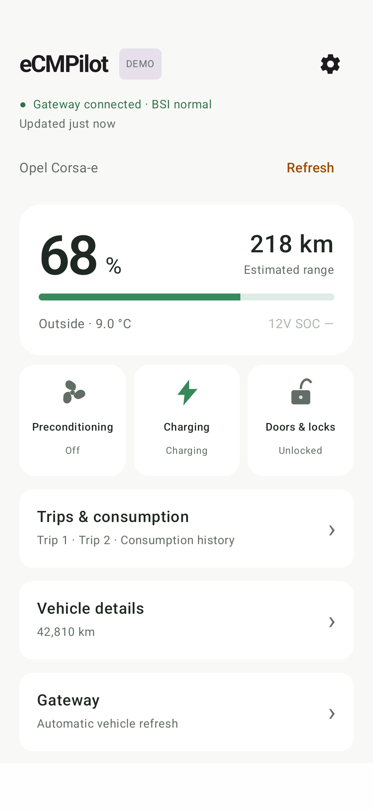
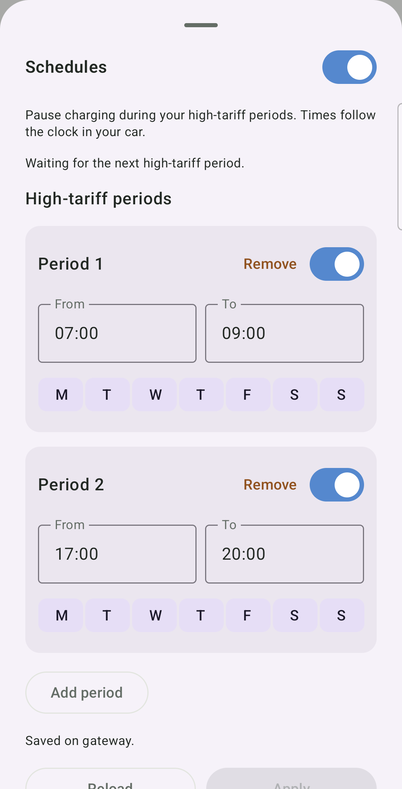
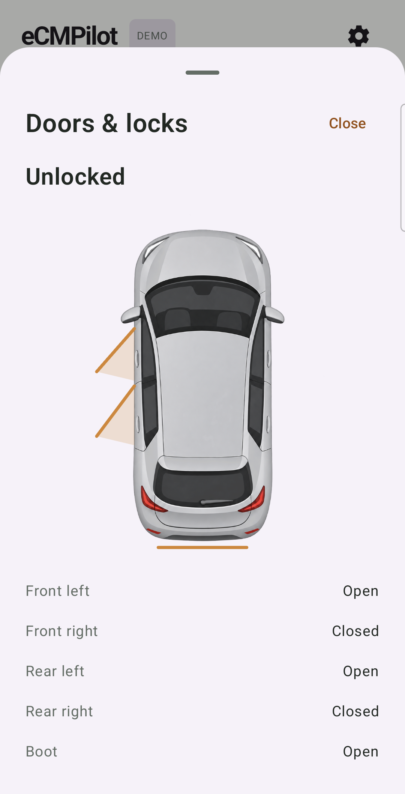
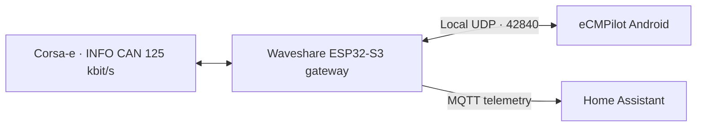

# eCMPilot

**A local Android companion for the Opel Corsa-e, using an ESP32 gateway on the vehicle's INFO CAN bus.**

Check battery level, charging, preconditioning and vehicle status over your own Wi-Fi network. The phone talks directly to the gateway; normal use does not require the manufacturer's cloud. An in-app demo lets you explore the interface without a gateway or vehicle.

The companion firmware is **`ecmpilot-gw`**, built for the **Waveshare ESP32-S3-RS485-CAN**. This repository contains the Android app and its local communication protocol.

**Status:** working development prototype, Android app **0.3.0**, tested with an Opel Corsa-e. Other Stellantis eCMP models are research targets, not a compatibility claim. This project is independent of Opel, Stellantis and Waveshare.

## A look at the app

The current interface below was captured on a physical Android phone on **2026-11-11**, using the in-process demo gateway. The full gallery also retains an earlier, clearly dated live-vehicle session.

<table>
<tr>
<td align="center"><br>Vehicle status &amp; vehicle clock · demo</td>
<td align="center"><br>Charging schedules · demo</td>
<td align="center"><br>Doors &amp; locks · demo</td>
</tr>
</table>

See the **[full screenshot gallery](docs/screenshots/README.md)** for charging, weekly schedules, trips, gateway settings, dark mode and failure handling, with live/demo provenance.

## What it does

- **Home:** traction-battery SOC, estimated range, average battery temperature, outside temperature, 12 V battery SOC, BSI state, observation age and the vehicle's own date/time.
- **Charging:** reported state and remaining time, immediate/delayed charging and its stored start time. Mode changes send immediately; valid time edits save after a short pause, without Apply. **Charge limit** has its own switch and a 30–100% slider, grey when disabled.
- **Charging → Schedules:** up to eight weekly high-tariff periods during which the gateway pauses charging, then resumes after its own pause. Uses the car's clock, without phone timezone or daylight-saving conversion. [How schedules work](docs/charging-schedules.md).
- **Preconditioning:** explicit Start/Stop, the reported state and four vehicle weekly program slots with time/day editors.
- **Doors & locks:** an overhead vehicle view with individual door/boot indications and reported locking state. This screen is for observation; it does not lock or unlock the car.
- **Trips & consumption:** Trip 1/2, electric consumption and six vehicle history slots. History slot duration/order is still under investigation.
- **Vehicle details:** INFO CAN measurements, 27 HSCAN/OBD readings grouped by battery, powertrain and heating/cooling, and connection diagnostics.
- **Gateway settings:** automatic vehicle refresh intervals and a minimum 12 V SOC, followed by automatic deep sleep and Charge limit. These features run on the gateway even when the phone app is closed.
- **Gateway → OBD adapter:** scan for compatible BLE ELM327 adapters and save one on the gateway. [Adapter support and HSCAN observations](docs/gateway-obd.md).

The gateway advertises its available fields and operations; unsupported functions stay unavailable. Reported preconditioning status is vehicle feedback, not independent measurement of heat or airflow. Some body/trip mappings and program writes still need further vehicle validation.

## How it connects



MQTT is an optional, separate gateway-to-Home Assistant path. The Android app does not need an MQTT broker. The current MQTT integration publishes telemetry only.

Opening the app, reconnecting and reading cached data **do not wake the car**. **Refresh** explicitly runs a vehicle wake/read sequence; an enabled automatic refresh does the same on a gateway-owned schedule. A refresh can also activate charging, as observed on the test vehicle.

Cached values keep their original observation ages. Values older than five minutes are shown grey, and disconnected data is dimmed immediately. Cached vehicle readings are held in memory and do not survive a gateway reboot. Missing INFO CAN battery energy/capacity, HV voltage/current or measured cabin temperature is not fabricated.

Charge limit uses delayed charging to pause at the target after an updated SOC is received. It depends on automatic refresh, is not a native battery charge cutoff, and the vehicle can resume at its stored charging start time. See [automatic refresh and Charge limit](docs/auto-refresh.md).

## Try it without a car

1. Build and install the app below.
2. It starts in **DEMO** mode. Open the settings gear to choose a demo scene and light/dark/system appearance.
3. Explore charging, preconditioning, doors, trips and gateway settings. Demo uses an in-process simulated gateway and creates no network sockets.

## Connect to your gateway

1. Install and configure the `ecmpilot-gw` firmware, including its vehicle wiring and Wi-Fi.
2. Put the phone and gateway on the same reachable local network.
3. In the app's settings, select **Local gateway**. **Find gateway automatically** is on by default: mDNS finds the saved gateway even if its IP changes, including on the gateway's own AP. The hostname/IP field is a fallback; defaults are **`ecmpilot-gw.lan`**, UDP **`42840`**. Disable automatic discovery for manual-only operation. The `.lan` fallback depends on your router's DNS; direct AP IP is **`192.168.4.1`**.
4. Grant local-network permission if requested, then **Save & connect**. The app remembers the gateway identity; use **Forget saved gateway** when replacing the device.
5. Monitoring is passive. Supported control operations additionally use the gateway's capability checks and the relevant experimental-control opt-in.

Local UDP currently has **no authentication or encryption**; the remembered identity is not cryptographic pairing. Use a trusted network and do not expose the gateway ports to the internet. A VPN must allow a route to the local gateway; connection diagnostics records the selected routing path.

## Build

Kotlin / Jetpack Compose / Material 3. **Android 9+ (API 28)**; compile/target SDK **37**, Java **17**. Install Android Studio and Android SDK 37. Gradle Wrapper pins the build toolchain.

From the repository root on Windows:

```powershell
.\dev.ps1 build
.\dev.ps1 check
.\dev.ps1 devices
.\dev.ps1 install -Device YOUR_DEVICE_SERIAL
```

The helper finds Android Studio's JBR and the per-user Android SDK. Override `JAVA_HOME` / `ANDROID_HOME` when needed. `build` produces `app/build/outputs/apk/debug/app-debug.apk`; `check` runs JVM tests and lint. `-Offline` uses cached dependencies.

On other systems, configure Java/Android SDK and use the wrapper:

```sh
./gradlew :app:assembleDebug
./gradlew :app:testDebugUnitTest :app:lintDebug
```

Release builds use an upload key and `signing/release.properties`, both local and
ignored by Git. `dev.ps1 release` builds the signed Play AAB and release APK and
runs JVM unit tests and release lint. See [release instructions](docs/releasing.md) for
first-key creation, backups, artifact checks and Git tagging. Debug builds do not
require a release key. Keep local SDK paths, passwords and build artifacts out of
version control.

## Documentation and tests

| Guide | Contents |
| --- | --- |
| [Screenshots](docs/screenshots/README.md) | Real-phone live and demo gallery; reproducible capture procedure |
| [Screen/data guide](docs/home-screens.md) | Vehicle screens, data availability and freshness |
| [Vehicle refresh](docs/vehicle-refresh.md) | Passive connection versus explicit vehicle action |
| [Automatic refresh](docs/auto-refresh.md) | Gateway timer configuration and Charge limit |
| [Charging schedules](docs/charging-schedules.md) | High-tariff pause periods and the vehicle clock |
| [Low power](docs/low-power.md) | Gateway inactivity sleep settings and countdown |
| [Protocol](docs/protocol/udp-v0.md) | UDP requests, observations, capabilities and command receipts |
| [Correlation/retries](docs/udp-correlation.md) | Stable operation IDs, packet loss and late replies |
| [Testing](docs/testing.md) | Unit/UI checks, demo scenes and Python UDP simulator |
| [Artwork](docs/app-icon.md) | App-icon provenance; [vehicle artwork](docs/assets/vehicle-top.md) |
| [Changelog](CHANGELOG.md) | Development changes |
| [Releasing](docs/releasing.md) | Signed Play AAB/APK, upload-key backup and version tags |

Vehicle research and wiring notes are under [wiring.md](wiring.md); the firmware repository is the installation reference. Signal availability depends on the selected bus, the vehicle's sleep state and the specific equipment/software version. Do not assume that a matching CAN ID proves the same meaning on another model.

## License

Original project code is **[BSD-2-Clause](LICENSE)**. Third-party libraries keep their own licenses; see [third-party notices](third_party/NOTICE.md). Community CAN research used by the companion firmware has its own attribution and validation records in that repository.

Experimental software, provided without warranty. Vehicle installation and control require appropriate electrical and vehicle validation. There is no official Opel/Stellantis affiliation or endorsement.
