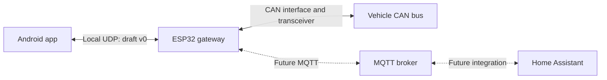

# eCMPilot

An independent, community-oriented Android app for monitoring and controlling supported Stellantis eCMP vehicles through an ESP32 CAN gateway installed in the vehicle.

The first target vehicle is an Opel Corsa-e. Support for other eCMP vehicles is a longer-term goal and will be verified per model and vehicle configuration.

**Status: Android prototype, version 0.2.0.** The phone app implements the proposed Home screen, Climate/Charging sheets, in-process demo, local UDP client, connection settings, freshness handling and diagnostics. A standalone UDP simulator is included. The separate `ecmpilot-gw` firmware now implements UDP monitoring and an explicit varstore test backend; real-vehicle command mappings remain unimplemented.

## Build and run

Open this directory in Android Studio with the Android 37 SDK installed. Kotlin / Jetpack Compose / Material 3, minimum Android 9 (API 28), target API 37. The application ID is `cz.ecmpilot`, independent of `android_dash`.

On Windows, the helper locates Android Studio's JBR and the normal per-user SDK; `JAVA_HOME` and `ANDROID_HOME` can override them:

```powershell
powershell -NoProfile -ExecutionPolicy Bypass -File .\dev.ps1 build
powershell -NoProfile -ExecutionPolicy Bypass -File .\dev.ps1 check
powershell -NoProfile -ExecutionPolicy Bypass -File .\dev.ps1 devices
powershell -NoProfile -ExecutionPolicy Bypass -File .\dev.ps1 install -Device SERIAL
```

`build` creates `app/build/outputs/apk/debug/app-debug.apk`; `check` runs JVM unit tests and Android lint. `install` installs and opens this app on the explicitly selected device (or one attached physical device). `-Offline` uses already-cached dependencies. Gradle Wrapper 9.4.1 has a pinned distribution checksum. No release signing keys or Play Store upload are configured.

The app starts in clearly labelled **DEMO** mode and creates no sockets in that mode. Open **Settings** to choose the source, demo scene or appearance. It supports both system light/dark themes and a manual theme choice. See [testing and simulator instructions](docs/testing.md) and the [prototype verification record](docs/verification.md).

### ESP32 varstore bench backend

Firmware `ecmpilot-gw` 0.3.0 serves UDP on port 42840 and starts read-only. Enable/seed its test inputs using that repository's `tools/udp_bench.py --host GATEWAY_IP seed`, then connect here with Local gateway, opt into experimental local controls and Refresh. The app shows **TEST** for `control_backend: "varstore-test"`; these are varstore observations and commands, without CAN access. Start/stop and charge-mode requests wait for matching observed state in the gateway's web Varstore tab. No matching readback gives an unconfirmed result. Deferred test mode does not create a persistent vehicle schedule.

The firmware reports test operations with `verified: false`. Only this explicit backend can enable them for bench use; ordinary unverified or unknown backend operations remain disabled. The normal lab-control opt-in is still required. Older Android builds remain read-only with this backend.

### Connect a local gateway

1. Put phone and gateway on the same local Wi-Fi/Ethernet network. In **Settings → Local gateway**, enter the hostname/IP and UDP port (default `42840`).
2. On Android 17+, allow **local network access**. Denial leaves demo usable and live networking disabled. See [Android's platform guidance](https://developer.android.com/privacy-and-security/local-network-permission).
3. Save and connect. The app learns the gateway ID on first successful contact, then requires it to match. **Forget saved gateway** permits changing to a different gateway; this identity check is not cryptographic authentication.
4. Live connections default to monitoring. **Allow experimental local controls** opts into the unauthenticated `lab-plain` profile. The gateway must additionally advertise the exact operation as verified and confirmable; fresh vehicle state and a matching boot/domain generation are required before submission. No raw CAN/UDS terminal is exposed.

The current UDP profile has no authentication or encryption. Use the simulator/isolated development setup while vehicle integration is being researched. The app does not implement the planned pairing/DTLS profile and will not enable control for an unknown security profile.

Accepted operations finish on the gateway, not on an Android alarm. The app reports success only from a matching command result; acceptance/timeouts do not become optimistic success. Pending request IDs are stored before dispatch so process recreation can query the original result. Reconnection never automatically starts a new copy of an old command.

## Project goals

- Provide a local alternative to the vehicle functions offered by MyOpel, starting with the owner's Corsa-e.
- Read vehicle status and add supported control functions as the required CAN messages are understood and verified.
- Operate over a known local Wi-Fi network without requiring the manufacturer's cloud for the planned local connection.
- Support both an Android user interface and Home Assistant integration.
- Make the source available under BSD-2-Clause so anyone can build, modify, and redistribute the software, including commercially, under that license.
- Offer a paid Google Play build for convenient installation, updates, and support for development. A self-built version is intended to provide the same functionality without an app purchase.

## Planned architecture

The ESP32 is the vehicle gateway. It connects to the vehicle's CAN bus through suitable CAN interface hardware and joins a configured, known Wi-Fi network. The Android phone is on the same local network and communicates directly with the gateway using the proposed UDP protocol. MQTT/Home Assistant is a later integration, outside the first implementation slice.



The Android-to-gateway connection and MQTT connection use the local network. The MQTT broker may run on the Home Assistant host or another reachable machine. A broker is required for the planned MQTT integration; it is not intended to be required for direct Android access.

### Android application — this repository

- Discover or configure the gateway's local address and establish a connection.
- Display vehicle data, connection state, and data freshness.
- Send supported commands and display their outcomes, including failures and timeouts.
- Provide gateway connection settings and diagnostics.
- Keep vehicle-specific details behind an interface that can grow to support additional verified models.

The app uses Kotlin / Jetpack Compose / Material 3 and the same pinned toolchain versions as the sibling `android_dash` project. See the [app design](docs/app-design.md) for the product intent and the [original mockup](docs/mockups/control-app.html) for simulated design flows. The native implementation is in `app/`; the HTML is not embedded in the APK.

### ESP32 firmware — planned separate repository

- Connect to the selected CAN bus and translate verified vehicle messages into a documented data model.
- Expose that model and supported commands over the local application protocol.
- Later, publish vehicle state and accept supported commands through MQTT for Home Assistant.
- Join and reconnect to configured Wi-Fi networks.
- Report gateway health, supported capabilities, and protocol version.
- Handle vehicle sleep, wake-up behavior, and power consumption appropriately for an installed device.

The proposed firmware repository name is `ecmpilot-firmware`; it has not been created as part of this documentation setup.

The exact ESP32 variant, CAN interface/transceiver, power supply, physical installation location, CAN connection point, bus parameters, and supported vehicle messages are still to be determined. The ESP32 board alone is not a complete electrical CAN interface.

The [Waveshare ESP32-S3-CAN-2CH-U power review](docs/hardware/waveshare-esp32-s3-can-2ch-power.md) traces the manufacturer's schematic and estimates parked consumption. Its permanently powered isolation supply makes the unmodified kit unlikely to meet the proposed 10 mA budget at 12 V; it remains a development candidate, pending measurements and confirmation of fitted components.

The updated gateway requirement is **non-isolated CAN with onboard switching power**, targeting at most 10 mA from 12 V while parked. The [replacement hardware shortlist](docs/hardware/non-isolated-can-shortlist.md) compares CANipulator V2, WiCAN-USB and other assembled kits, distinguishing confirmed circuit details from unresolved specifications and Wi-Fi-reachable idle from offline sleep. No replacement board is qualified yet.

### Local Android communication

Local unicast UDP is implemented against the [experimental v0 contract](docs/protocol/udp-v0.md), using two application message families: requests and status replies carrying observations and command outcomes. One command can require multiple datagrams and a separate native CAN exchange. Manual address configuration is implemented; discovery remains future work.

The draft addresses the following, with hardware and on-car validation still required:

- Discovery and manual address configuration.
- Vehicle state, units, timestamps, and stale-data behavior.
- Command identifiers, acknowledgements, execution results, and timeouts.
- Duplicate-command handling and retry rules, especially if UDP is used.
- A lab profile and a future local pairing/authentication boundary. Being on the same Wi-Fi network is not command authorization; authentication is not implemented by this design sketch.
- Capability negotiation and compatibility between app and firmware versions.

### Home Assistant integration

MQTT is the future integration path. Keep state and command handling independent of the UDP adapter, but do not add a broker, MQTT settings or topic implementation to the first version. Topic names, payload schemas, broker credentials, availability reporting, retained-message behaviour, and Home Assistant MQTT Discovery support will be specified when that integration is scheduled. Command topics must have explicit handling for stale or repeated requests.

## Repository boundaries

Keep the Android app and ESP32 firmware in separate repositories. They have different build tools, hardware dependencies, release cycles, and installation processes.

| Repository | Responsibility |
| --- | --- |
| `ecmpilot` | Android application, app documentation, and initially the app-to-gateway protocol specification. |
| `ecmpilot-firmware` (planned) | ESP32 firmware, hardware setup, CAN integration, MQTT implementation, and firmware releases. |

The two projects will share a versioned protocol contract covering messages, capabilities, errors, and compatibility. Its initial draft lives in [docs/protocol/](docs/protocol/udp-v0.md); the firmware repository should reference a specific revision. A third repository is only needed if the shared protocol or tooling grows enough to justify it.

App and firmware version numbers may evolve independently; releases must state which protocol versions they support.

## Development plan

1. **Define the first vehicle and hardware setup.** Record the Corsa-e model/configuration, select the ESP32 and CAN hardware, and determine installation location, power supply, and CAN access point.
2. **Establish read-only vehicle communication.** Capture and identify relevant CAN traffic, validate initial signals against the vehicle, and document the findings in the firmware project.
3. **Validate the local protocol draft.** Exercise the proposed UDP data model, capabilities, command lifecycle, expiry and compatibility against a simulator; define the local pairing/authentication implementation.
4. **Build a minimal Android app.** Connect to a gateway or simulator, show connection health and a small set of verified vehicle readings, and handle disconnects and stale data.
5. **Add verified control functions.** Start with native cabin preconditioning and immediate/deferred charging mode, subject to on-car verification. Implement commands incrementally with observable results and defined timeout/retry behaviour. Adjustable temperature, charging pause/current and target SOC require their own verified capabilities.
6. **Integrate Home Assistant.** Add MQTT state, availability, and supported commands; evaluate MQTT Discovery.
7. **Validate installed operation.** Check Wi-Fi reconnects, vehicle sleep/wake cycles, power draw, interrupted commands, and protocol compatibility across releases.
8. **Prepare community and store releases.** Add build instructions, include required dependency notices, document supported hardware/vehicles, and prepare a paid Google Play distribution alongside the source release.

## Scope and open decisions

- The first connection model is local access while the gateway and phone share a network. Remote access over the internet is outside the initial plan.
- A shared vehicle platform does not guarantee identical CAN messages or feature support across models.
- Charging, climate control, and other possible functions will only enter the supported feature list after verification on the target vehicle.
- Firmware updates, initial Wi-Fi provisioning, and recovery procedures still need a design.

## References

- [PSA-RE](https://github.com/prototux/PSA-RE) - Community research into PSA/Stellantis electrical architectures, CAN messages, ECU definitions, and diagnostics. A key reference for investigating eCMP vehicle communication and remote-control messages. Definitions must be checked against the target vehicle and architecture variant; see [wiring.md](wiring.md) for the inspected snapshot, specific research leads, and validation plan.

## License

This repository is licensed under the [BSD 2-Clause License](LICENSE), SPDX identifier `BSD-2-Clause`.

You may use, modify, and redistribute the project in source or binary form, including commercially and as part of closed-source products, provided you preserve the required copyright notice, license conditions, and disclaimer. Publishing modifications is welcome but is not required by this license. The software is provided without warranty; see the full license text for its terms.

The same license is intended for the future firmware repository and should be added there when that repository is created. Third-party dependencies retain their own licenses and distribution requirements.

## Development status

See [wiring.md](wiring.md) for the initial Corsa-e CAN architecture investigation, consolidated eCall connector wiring, candidate gateway connection points, power/ground references, and remote-command research plan.

See [docs/app-design.md](docs/app-design.md) for the proposed phone UI and feature priorities, [the mockup](docs/mockups/control-app.html) for simulated interactions, and [docs/protocol/udp-v0.md](docs/protocol/udp-v0.md) for the local UDP contract and future MQTT seam.

See the build instructions above and [CHANGELOG.md](CHANGELOG.md) for project changes. Real ESP32/vehicle validation and authenticated pairing remain separate work; prototype capabilities are not a compatibility claim for the Corsa-e.

eCMPilot is an independent project and is not affiliated with, endorsed by, or supported by Opel or Stellantis. Product and platform names identify the intended vehicle compatibility.
