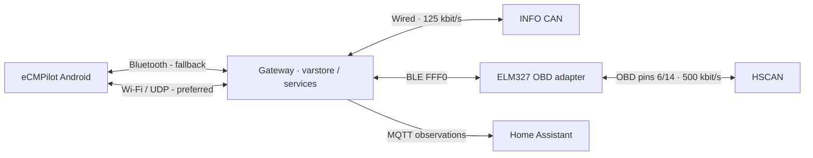
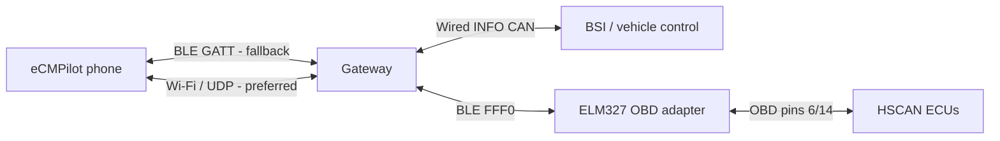

# Gateway OBD adapter

Open **Gateway → OBD adapter → Find adapters**, select a Bluetooth address and
choose **Save adapter**. The gateway performs the eight-second scan and stores
the selected address and address type in its own nonvolatile settings. The
phone configures the adapter through GW; it never connects to the OBD adapter
directly. Bluetooth permission on the phone is needed for the phone-to-GW BLE
connection, not for GW's adapter scan.
The selection is shared with the gateway web editor and survives a reboot.

## Implemented connection

The app configures the gateway over Bluetooth or Wi-Fi/UDP. GW performs the adapter
scan and adapter communication, and returns cached vehicle readings to the app.

Disconnect other OBD applications before use. After an explicit or automatic
vehicle refresh, the gateway briefly connects to the saved adapter, samples its
HSCAN messages and disconnects from the adapter. The phone's BLE connection
remains available. Opening this screen or Vehicle details
only reads cached data; it does not wake the vehicle or start a snapshot.

## Supported adapters

The current gateway supports the BLE ELM327 UART family with service **FFF0**,
notifications **FFF1**, writes **FFF2**. Scanning filters by the advertised
service, not by the device name. Connection verifies the GATT layout and the ELM
identification response. Saving an address is not security pairing: there is no
PIN, bonding, or support for other BLE UART profiles yet.

Android Dash currently uses **Bluetooth Classic/SPP**, including selection from
Android's paired devices. The ESP32-S3 gateway cannot use that transport. An
adapter must expose the supported BLE interface to work with this gateway,
even if it also works with Android Dash over Classic.

## Vehicle details

**HSCAN / OBD** contains 27 readings grouped into traction battery,
powertrain, and heating/cooling: energy, SOC, pack voltage/current, battery and
cell measurements, SOH, insulation, coolant and component temperatures, heater
and evaporator setpoints, airflow, compressor current and charging time.

The readings were checked against vehicle observations on 2026-11-13. Current
is an unsigned magnitude, and compressor current is not a measured heating-power value. OBD SOC
is shown separately from the main INFO CAN SOC. Missing values show `-`; retained
observations turn grey after five minutes, using their own original ages.
Temperatures use one decimal place; cell voltages retain three. Home shows the
average battery temperature above the outside temperature, with its own age.

## Local protocol

The gateway advertises `elm327` and `obd` in `info.fields`.

| Operation | Arguments | Response |
| --- | --- | --- |
| `elm327.get` | `{}` | Compact `elm327` configuration, scan state and results |
| `elm327.scan` | `generation` from the last get | Updated `elm327`; scan completes asynchronously |
| `elm327.set` | `rev`, `address`, `address_type` (`public`/`random`) | Saved `elm327` configuration |
| `obd.get` | `page`: 0–4 | `obd: {page, pages:5, readings:{...}}` |

Mutations require the current gateway/boot identities. Scan uses compare-and-start
on the operation generation; retransmission cannot restart a completed scan.
Repeating the same saved configuration with the immediately previous revision
returns the saved result without another flash write. Conflicting settings are
rejected. A busy adapter cannot be reconfigured.

The compact scan list uses tuples `[address, address_type_number, rssi_dbm]`, with
type 0 for public and 1 for random. At most six results are returned. Each OBD
page carries at most six readings as `{value, age_ms}`, with null for unknowns.
Pages merge by key, keep independent source ages and clear on gateway restart.
They are cached observations, not an atomic simultaneous measurement. All
responses fit the existing 1024-byte UDP limit.

## BLE connection to gateway

Automatic phone-to-GW BLE discovery and connection were confirmed on a physical
Android phone and gateway on **2026-11-13**. Selection was revised on
**2026-11-14**: Wi-Fi/UDP has priority, with Bluetooth used only when GW is
unreachable over the local network. All existing polling
and operations preserve JSON request/correlation identity on a transport switch.
The general UDS service and dashboard integration remain planned.

Turn on the phone's Bluetooth. In **Settings / Connection**, select **Local
gateway**, tap **Allow Bluetooth & local network** and grant the requested
permissions, then **Save & connect**. The app tries Wi-Fi/UDP first; BLE discovery
runs automatically only when the network path is unavailable. There is no separate
GW scan button or system Bluetooth pairing step.
No system PIN or bonding is used by this initial lab transport. The saved gateway
identity selects the device. First setup without a saved identity requires
exactly one advertising gateway nearby. Home shows
**Gateway connected via Bluetooth** while BLE carries the requests.

While using BLE, the app checks Wi-Fi/UDP in parallel at five-second intervals
using passive `info.get` requests. A responding gateway must match the saved
identity. The next application request uses the recovered UDP path, then closes
the phone BLE connection and stops its scan. Failed probes do not delay BLE
polling or cause vehicle wake/refresh. Probes stop when the app connection closes.

This phone link replaces Wi-Fi/UDP when away from a reachable
local network. The phone can keep mobile internet without joining the GW AP.
Wi-Fi/UDP remains available at home. GW uses one BLE stack with two
connections: peripheral/GATT server for the phone and central/GATT client for ELM.
Web/OTA access continues over Wi-Fi. MQTT requires the gateway's own reachable
IP connection to its broker; the BLE app link does not provide internet tethering.

The integrated dashboard will call **GW UDS services**, selecting the requested
ECU/DID and consuming the response or reported failure. Adapter connection,
GATT operations, ELM AT commands, addressing/filter configuration and diagnostic
exchange handling belong to GW. Metric decoding and display can remain in the
app. The existing Android Dash direct-to-ELM connection is not required for this
design.

GW must serialize diagnostic requests and its passive snapshots, retaining one
owner of the ELM interpreter. A bounded dashboard session will release adapter
ownership on disconnect or inactivity. The phone connection alone remains
passive, with existing explicit vehicle refresh/wake behavior preserved.
Framing, notifications and transport selection are implemented. Pairing/bonding
and the general UDS API remain future work. An ELM snapshot releases only the
adapter connection, preserving the phone's shared BLE host and link.

The confirmed phone connection does not yet validate simultaneous phone/ELM
sampling, physical BLE/UDP failover, vehicle actions over BLE or operation without
phone Wi-Fi. Those scenarios and sustained radio coexistence remain to be checked.

The limited web battery-temperature test already exists; it is not the general
UDS service planned for the dashboard. Additional connection memory, sustained
UDS throughput and Wi-Fi/MQTT coexistence need measurement on the gateway.
