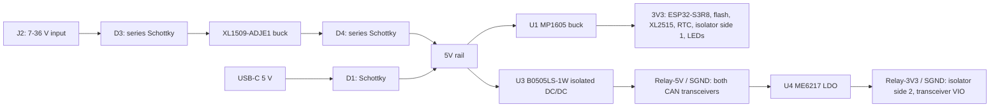

# Waveshare ESP32-S3-CAN-2CH-U: power review

Reviewed 2026-10-23. Requirement: an assembled kit wired into the car, no custom PCB, nominal 12 V supply, at most 10 mA while parked, preferably still reachable over local Wi-Fi.

**Assessment: useful dual-CAN development hardware, but a poor candidate for a guaranteed <=10 mA permanent installation in its unmodified form.** The main ESP supply is switched, but the CAN isolation supply is permanently enabled. The reference calculation gives about **21 mA at 12 V with ESP and external CAN controller asleep**, and about **31 mA with a power-saving Wi-Fi connection**. These are engineering estimates, not measurements or manufacturer specifications.

The strongest finding does not depend on an assumed Wi-Fi current: the isolated converter's published approximate no-load power and the input buck's typical quiescent current already consume about **12.4 mA at 12 V** in the reference model, before downstream loads. This is a typical-value warning, not a guaranteed lower bound for every unit.

## 1. Evidence and variant scope

Waveshare's [resource page](https://docs.waveshare.com/ESP32-S3-CAN-2CH/Resources-And-Documents) covers both CAN-2CH and CAN-2CH-U and links to the same schematic. The U variant uses the external antenna; no separate U power schematic was found. The delivered unit's PCB revision and fitted parts still need checking.

- [Manufacturer schematic at inspected commit](https://github.com/waveshareteam/ESP32-S3-CAN-2CH/blob/aa084b3caa14fb99802c1417e3772c43f959e5f6/hardware/schematics/ESP32-S3-CAN-2CH.pdf).
- Schematic commit: `aa084b3caa14fb99802c1417e3772c43f959e5f6`, dated 2026-09-18.
- PDF: one A4 page; metadata creation date 2026-09-15.
- SHA-256: `4f4f46fd6976447ab4fab6c6e8dfe42cfcadcfd3fcaaaaa85c86c807d79da180`.
- [Manufacturer hardware reference](https://github.com/waveshareteam/ESP32-S3-CAN-2CH/blob/d72279de7161ec95ea5ede89fd14cb515515a6d5/HARDWARE_REFERENCE.md) was cross-checked against the actual circuit, rather than treated as a complete BOM.

Evidence labels below: **circuit** = directly visible connection/value; **datasheet** = component vendor specification; **assumption** = calculation input; **measurement needed** = not established by the available documents.

## 2. Power architecture



The two CAN ports share the isolated power domain. They are isolated from MCU/input ground; the drawing does not provide independent galvanic isolation between CAN1 and CAN2.

| Circuit block | What the schematic establishes | Effect on parked consumption |
| --- | --- | --- |
| XL1509 input buck | ON/OFF tied low; feedback R8=12 kOhm, R9=41.2 kOhm; D4 follows the switching output | Always enabled, including ESP deep sleep |
| U1 MP1605 | EN pulled to 5 V through R1=100 kOhm | Main 3.3 V remains on; efficient at light load, but cannot remove other rails |
| U3 B0505LS-1W, marked K-CUT | Input connected to 5 V; four-terminal module with no enable pin | Isolation supply runs regardless of ESP/CAN software state |
| U4 ME6217C33M5G | CE tied to isolated 5 V | Isolated 3.3 V remains enabled |
| U11 pi163E31 isolator | Both sides powered; no shutdown control exposed | Static supply currents remain even when signals do not change |
| U8/U10 CAN transceivers | VCC on Relay-5V, VIO on Relay-3V3; S pins through R24/R25 to SGND, no MCU control shown | No firmware-controlled transceiver standby demonstrated |
| U9 XL2515QF20 | Separate SPI controller at 3.3 V; INT to GPIO18 | Must explicitly enter sleep; stopping ESP TWAI does not stop this controller |
| LED1 | 3.3 V power LED through 5.1 kOhm | Permanently consumes roughly 0.25-0.3 mA on the 3.3 V rail, depending on LED voltage |
| Activity LEDs | Driven from CAN signals through resistor networks | Traffic-dependent load; not universally switchable off in firmware |

The XL1509 resistor ratio gives about **5.45 V before D4**, using the vendor's 1.23 V feedback reference. The rail labelled `5V` is after the diode and depends on its forward drop. Calculations use nominal 5 V; the actual idle rail and isolated output voltages must be measured.

**The CAN transceiver part numbers are missing from the published schematic.** U8/U10 pin names suggest a 5 V transceiver with 3.3 V VIO and an S mode pin, but this does not identify the fitted IC. R24/R25 also have no numeric values in the PDF. A photograph of the markings or an actual BOM is needed before assigning exact standby currents or mode behavior.

## 3. Component data and uncertainty

| Item | Published data | How used here |
| --- | --- | --- |
| [XL1509, rev. 2.6, p.6](https://www.xlsemi.com/datasheet/XL1509-EN.pdf) | Quiescent current 2 mA typical, 10 mA maximum under its specified feedback test; shutdown 80 uA typical | 2 mA typical input overhead; shutdown is unavailable without hardware changes. This is not a measured whole-converter no-load current |
| [K-CUT B_LS-1W, pp.1-2](https://taoic.oss-cn-hangzhou.aliyuncs.com/temp/product/18680668620_1575625657000.pdf) | Note states no-load power about 10% of rated output; 1 W model therefore about 0.1 W; B0505LS-1W full-load efficiency 80% typical | 100 mW fixed-loss reference; 80-120 mW sensitivity cases are assumptions, not published limits. Full-load efficiency is not used as a proven light-load efficiency |
| [MP1605](https://www.monolithicpower.com/en/mp1605.html) | 11 uA typical quiescent current | Small compared with input buck and isolation. Incremental 3.3 V conversion efficiency is assumed, not measured |
| [ME6217 vendor datasheet, electrical table](https://file.elecfans.com/web2/M00/23/7A/pYYBAGGtiqGAD39nAAPOJTU-v5E942.pdf?ME6217_Microne.pdf=) | No-load operating current 100 uA typical, 130 uA maximum | Includes LDO own current plus its output current on the isolated 5 V rail |
| [2Pai pi163E family, rev.1, pp.6-7](https://cdn.promelec.ru/upload/items/2023/06/28/2Pai-Semi--160E-161E-162E-163E_.pdf) | pi163Exx at 3.3 V: about 1.53-1.554 mA typical **per side** for static inputs | Both sides counted on their respective rails; activity increases current |
| [XL2515 family, rev.1.1](https://datasheet.lcsc.com/lcsc/2012081507_XINLUDA-XL2515-TSS_C609745.pdf) | Family headline: active 5 mA typical, sleep 1 uA typical | Scenario input; available sheet is not an exact QF20 package characterization. Confirm firmware/register behavior on the fitted device |
| [ESP32-S3, v2.2, tables 5-7 and 5-10](https://documentation.espressif.com/esp32_s3_datasheet_en.pdf) | Chip deep sleep 7-8 uA; Wi-Fi TX example 340 mA at 3.3 V; R8/PSRAM can add consumption | Distinguishes chip current from board input. Associated Wi-Fi averages are explicit assumptions, not these peak/sleep specifications |
| U8/U10 reference comparison | [NXP TJA1051](https://www.nxp.com/docs/en/data-sheet/TJA1051.pdf) lists normal recessive 5 mA typical and normal dominant TX 50 mA typical | **Not an identification of the board parts.** Uses 2.5/5/10 mA per transceiver for sensitivity only, plus a small VIO allowance |

The isolated regulator's 800 mA rating is a capacity, not its consumption. In the reference quiet model, the LDO dissipates only about **3.4 mW**. The approximately 100 mW idle isolation loss is a much larger issue.

K-CUT also gives a minimum load / light-load regulation caveat and recommends avoiding no-load operation. Check the isolated rail voltage in the quiet state; nominal `Relay-5V` must not be assumed exact under very light load. The scope of this review does not establish automotive transient qualification from the 7-36 V operating range.

## 4. Calculation model

Currents are summed as **power at the correct supply rail**, not by adding 3.3 V currents directly to the 12 V input current.

```text
I12_mA = Iq_input_mA + (P5_main_mW + P5_isolation_mW) / (Vin_V * eta_input)

P5_main_mW = 3.3 * I3V3_main_mA / eta_main

P5_isolation_mW = P0_isolation_mW
                   + 5 * I5V_isolated_load_mA / eta_isolation_incremental

I5V_isolated_load_mA = 2 * I_CAN_VCC_mA
                       + I_isolator_side2_mA
                       + I_CAN_VIO_total_mA + I_LDO_own_mA
```

The last expression treats the isolated 3.3 V loads as LDO input current. They must **not** be converted with a buck efficiency. Input and isolation efficiencies in this model describe incremental load conversion; fixed quiescent/no-load losses are added separately. Applying a measured total converter efficiency that already includes those fixed losses would double-count them.

Reference assumptions:

- Input incremental efficiency 80%; main 5-to-3.3 V efficiency 90%; isolated incremental efficiency 80%.
- Input buck quiescent current 2 mA, isolation fixed power 100 mW.
- Two CAN receivers at 5 mA each, isolator 1.53 mA per side, total transceiver VIO allowance 0.16 mA, LDO own current 0.1 mA.
- Power LED 0.294 mA at 3.3 V; other main housekeeping allowance 0.1 mA.
- Deep-sleep scenario: ESP 0.008 mA, external flash 0.01 mA, XL2515 family sleep assumption 0.001 mA. These do not establish the entire R8/PSRAM package's sleep current.
- Wi-Fi power-save scenario: average ESP-domain current **assumed 20 mA**, flash allowance 1 mA and active XL2515 5 mA. No stock firmware benchmark is implied.
- Capture scenario: ESP-domain average **assumed 80 mA**, flash allowance 10 mA, active XL2515 5 mA, activity-LED allowance 3 mA at 3.3 V.

Reference deep-sleep contribution at 12 V:

| Contribution | Input-equivalent current |
| --- | ---: |
| Input buck's own current | 2.00 mA |
| Isolated converter fixed loss | 10.42 mA |
| Isolated downstream loads, including conversion allowance | 7.68 mA |
| Main 3.3 V loads, with ESP and XL asleep | 0.74 mA |
| **Total** | **20.84 mA** |

Even an intentionally incomplete calculation using only the first two rows is `2 + 100/(12*0.8) = 12.42 mA`. It explains why an ESP deep-sleep number cannot support a <=10 mA claim for this board.

## 5. Scenario estimates

The sensitivity cases change converter loss/efficiency and assumed peripheral/radio loads together. They are **not statistical confidence intervals, guaranteed min/max ratings, or measurements**. The 10 mA maximum specified for the XL1509 quiescent test is not used in these cases: replacing the 2 mA typical assumption by 10 mA adds another 8 mA. Other corners may exceed the table too.

| Scenario, unmodified hardware at 12 V | Optimistic case | Reference case | Conservative case | Wi-Fi reachable? |
| --- | ---: | ---: | ---: | --- |
| ESP deep sleep; XL controller still active | 14.8 mA | 22.7 mA | 39.9 mA | No |
| ESP deep sleep; XL controller also asleep | 13.2 mA | 20.8 mA | 35.6 mA | No |
| Associated Wi-Fi with power saving, quiet CAN | 16.6 mA | 30.8 mA | 58.4 mA | Yes, subject to firmware/AP behavior |
| CAN capture with active Wi-Fi | 32.2 mA | 58.3 mA | 102.8 mA | Yes |
| Wi-Fi TX snapshot, CAN locally recessive | 107.1 mA | 157.6 mA | 197.8 mA | Yes; this is a short event, not an idle average |

The optimistic/conservative assumed ESP averages are 5/40 mA for associated power-save and 50/120 mA for capture. Isolation fixed loss is 80/120 mW, input incremental efficiency 90/75%, main efficiency 95/85%, isolation incremental efficiency 90/65%, and the assumed normal recessive transceiver current is 2.5/10 mA per port. This makes the sensitivity deliberately visible and reproducible. The accompanying CSV/JSON in the review deliverable contain the full values.

At 14.4 V, the reference optimized-sleep and associated-Wi-Fi cases become about **17.7 mA** and **26.0 mA**, respectively. A comparison made only at charging voltage would be too favorable for a parked 12 V battery.

At 12 V, reference optimized sleep corresponds to about **15 Ah per 30 days**; reference Wi-Fi power-save about **22 Ah per 30 days**. The user's accepted 10 mA budget itself is 7.2 Ah per 30 days. These are arithmetic draws from the auxiliary battery, without assuming how the vehicle replenishes it.

## 6. What firmware can and cannot change

Firmware can reduce ESP CPU/radio duty, disable BLE and the configuration AP after setup, use static GPIO levels before sleep, put external flash/XL2515 into appropriate low-power modes, and avoid CAN transmissions while the car sleeps. CAN wake-up and retention need actual testing. Native TWAI is unavailable while the ESP is in deep sleep; wake-up from GPIO16 activity can lose initial frames. The external controller's GPIO18 interrupt is a possible wake source, subject to its verified register mode and retained interrupt behavior.

For Wi-Fi reachability, use modem sleep with **automatic** light sleep, as described in the [ESP-IDF sleep documentation](https://docs.espressif.com/projects/esp-idf/en/v5.2/esp32s3/api-reference/system/sleep_modes.html). Manual deep sleep disconnects Wi-Fi; the phone cannot wake the ESP with UDP. Automatic sleep while continuously receiving CAN is also constrained by peripheral/driver power-management locks and interrupt frequency; it is not guaranteed just by enabling a configuration option.

Firmware cannot, through the shown connections, turn off U3 isolation power, switch U4 off independently, gate the entire 5 V branch, disable the hardwired power LED, or select the CAN transceivers' S mode. Putting a CAN controller into listen-only/sleep is not the same as turning off its transceiver and isolation supply. Using just one port leaves the other port's hardware powered.

Hardware gating or removal of the isolation path would change the product and needs electrical checks; it conflicts with the current preference for an unmodified assembled kit. It is not included in the recommendation.

## 7. Measurement needed to qualify one sample

Use the input terminal, USB disconnected, a current-limited bench supply with enough transient capacity, and an independent powered/terminated CAN test network. Begin in listen-only mode. Measure at **12.0 V, 12.6 V and 14.4 V**, rather than mixing USB input readings with vehicle input readings.

| Step | State | Purpose |
| --- | --- | --- |
| 1 | Cold boot / Wi-Fi association | Capture peak and reconnect energy |
| 2 | Quiet CAN, normal firmware, Wi-Fi connected | Establish the actual useful parked state |
| 3 | Same, BLE/AP disabled and automatic power saving enabled | Quantify firmware savings with UDP responsiveness |
| 4 | ESP deep sleep, then XL sleep as a separate case | Identify the permanent hardware floor |
| 5 | Same with each CAN port idle/receiving independently | Expose LED/isolator/controller traffic contribution |
| 6 | Known CAN wake event, then UDP command to simulator/bench ECU | Check wake latency, lost initial frames and recovery |
| 7 | AP unavailable / weak signal / reconnect loop | Bound average consumption in a realistic failure case |

For each steady state, record mean current/energy over at least 10 minutes plus peak current and supply voltage. An oscilloscope/current profiler or suitable shunt logger is preferable to a slow multimeter alone; specify burden voltage and instrument range. Verify actual `5V`, `Relay-5V`, `3V3` and `Relay-3V3` voltages and U8/U10 markings. Do not jumper the isolation domains together to simplify measurement.

## Decision for eCMPilot

Keep this board as a candidate for **dual-bus capture and gateway firmware development**. Do not classify it as meeting the permanent <=10 mA parked requirement from its ESP32 specifications or the presence of buck converters. The circuit and available component data instead indicate a material fixed overhead that firmware alone cannot remove. A delivered sample could update the numerical estimate, but the current evidence does not justify recommending it as a proven low-current installation kit.
