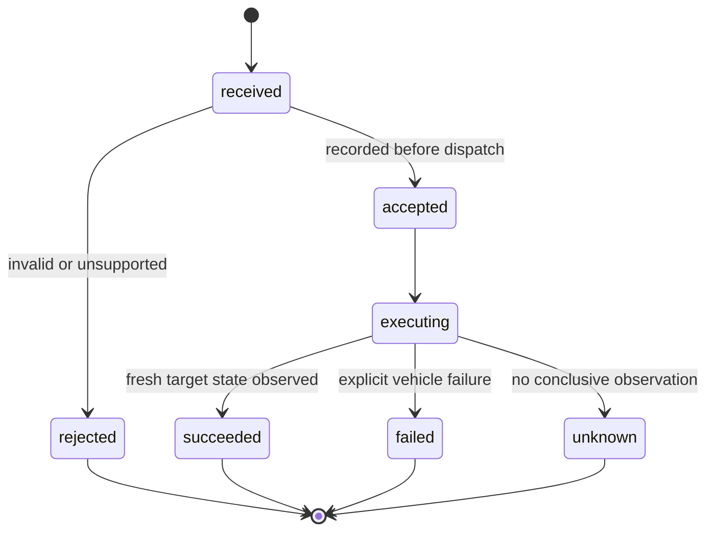

# Local UDP protocol: v0 design draft

2026-10-23. **Experimental implemented profile:** Android client and Python simulator use envelope version `v: 0`. ESP32 gateway 0.3.0 implements this binding for varstore observations and explicit bench commands; the INFO backend now implements experimental explicit refresh/charge-mode requests. See [passive connection and vehicle refresh](../vehicle-refresh.md). The binding is a local-network lab/simulator profile, not an authenticated vehicle-control service. See [app design](../app-design.md) and [testing instructions](../testing.md).

## Shape and scope

Two application message families are enough:

| Direction | Type | Use |
| --- | --- | --- |
| Android → gateway | `request` | Read info/state, query a command, or request one supported state change. |
| Gateway → Android | `status` | Reply with info/state and/or the lifecycle of a correlated command, including rejection. |

Acknowledgement is represented inside `status`, not a third message type. One action can still require several datagrams: request, acceptance, state queries and a final result. Vehicle CAN frames and any ISO-TP exchanges are a different layer entirely.

The [IETF UDP guidance](https://www.rfc-editor.org/rfc/rfc8085.html#section-3.3) explains that delivery, duplicate suppression and order are application concerns. The rules below are our proposed small LAN protocol, not a general reliable-stream implementation.

## Network binding

- Gateway joins an already configured Wi-Fi network. App connects using a manually configured host/IP and port first; a DHCP reservation is a useful deployment choice.
- Proposed configurable UDP port **42840**, a project-local choice, not an IANA assignment. Client uses an ephemeral UDP port; gateway replies to the actual request source address/port.
- Unicast control only. No broadcast commands, internet relay, NAT traversal or port-forwarding design. mDNS/Android NSD can later find the gateway; discovery is not proof of identity or permission to control it.
- One UTF-8 JSON object per application datagram. Maximum **1,024 application bytes** in either direction, measured after compact JSON encoding. Never split a JSON object across datagrams. Keep UDP checksums enabled. The cap is a conservative local-profile choice; validate it against the actual network path, especially if DTLS is added.
- Larger information is fetched as named profiles/pages, still using `request`/`status`, rather than growing every state message or relying on IP fragmentation.
- App polling: 1 Hz while a visible screen needs data; up to 2 Hz while awaiting a command, then back to 1 Hz. No regular background keepalive. Back off on errors; after three unanswered polls, use 2/4/8 s intervals, capped at 8 s until reconnect or user refresh. These are application state reads, not CAN wake requests.
- Intended first deployment: one gateway and a few local clients. Bound total request processing (initial proposal: 20 requests/s gateway-wide) and reply size; review under actual hardware measurements.

## Common identifiers

| Field | Definition |
| --- | --- |
| `v` | Integer application schema version, initially 0. Unsupported versions cannot execute a command. |
| `type` | `request` or `status`. |
| `gw` | Stable gateway ID. Mandatory and exact for state changes. Bootstrap `info.get` may use null. |
| `boot` | Random 128-bit boot ID, 32 lowercase hex characters, regenerated whenever command-cache state is lost. Mandatory for state changes. |
| `client` | Persistent random client installation ID, 32 lowercase hex characters. Correlation only; not an authenticator. |
| `id` | Random 128-bit request ID, 32 lowercase hex characters. New for each operation; the same ID and immutable content for every retransmission. |
| `domain_rev` | On a write request, the last observed command generation for its domain (`climate` or `charge`). Atomic compare-and-increment on acceptance prevents an older reordered request from undoing a newer action. |
| `reply_to` | In `status`, the request ID being answered. The app matches both request and expected gateway. |
| `seq` | In `status`, a monotonically increasing sequence for that gateway boot. It orders snapshots, not execution permissions. |
| `now_ms` | Gateway monotonic uptime in milliseconds, independent of phone/vehicle wall clocks. |

Unknown response fields can be ignored. Unknown operations or arguments in a write request are rejected rather than silently interpreted. Reject duplicate JSON keys, invalid types, oversized input, non-finite values and out-of-range arguments. The version and operation schema determine which fields are valid.

## Request operations

| `op` | Arguments | Notes |
| --- | --- | --- |
| `info.get` | `{}` | Identity, firmware/protocol information, security profile and capabilities. Separate from full state to stay within the byte cap. |
| `state.get` | `{}` | Current passive observations; must not wake or transmit CAN merely to refresh the UI. |
| `command.get` | `{"command_id":"…"}` | Current/cached lifecycle for a command owned by this client. May include a fresh snapshot if it fits. |
| `climate.set` | `{"enabled":true}` or false | Request a native preconditioning state. True/false support is separately advertised. No generic toggle. |
| `charge.mode.set` | `{"mode":"immediate"}` | Request a mode; success does not mean charging current exists. |
| `charge.mode.set` | `{"mode":"immediate","start_local":"03:17","timezone":"Europe/Prague"}` | Save the stored start time while leaving delayed charging off. The time is optional only in immediate mode; omission preserves it. Confirmation must include the requested time. |
| `charge.mode.set` | `{"mode":"deferred","start_local":"23:00","timezone":"Europe/Prague"}` | Native, persistent start schedule, only when verified. Gateway rejects timezone/clock ambiguity or unsupported scheduling. |

These write operations are candidate API names, not verified CAN commands. Arguments for unsupported temperature, SOC target, timer duration, raw CAN injection, arbitrary UDS requests or ECU services do not exist in the initial contract. Future features get explicit versioned capabilities/operations.

For `info.get`, report only the verified readable fields and supported operations/arguments, plus confirmation availability. An experimental feature may be described in diagnostics but must not appear as a normally supported control. A change in capabilities requires re-reading info before using newly available controls.

### Implemented capability response

`status.info` has `firmware` (string), `security` (`lab-plain` for the current UDP binding), `timezone` (IANA zone or null), `fields` (array of readable field names), and `operations` (object keyed by exact operation name). Its currently recognized entries are:

```json
{
  "climate.set": {"verified": true, "confirmation": true, "enabled": [true, false]},
  "charge.mode.set": {"verified": true, "confirmation": true, "modes": ["immediate", "deferred"], "persistent_schedule": true}
}
```

Both `verified` and `confirmation` must be true for the Android control to be available. A missing operation/value is unsupported. Deferred mode additionally requires persistent scheduling and a valid timezone. The app refreshes info before each write and periodically while visible; current live controls are an explicit settings opt-in. These flags are not a cryptographic trust mechanism. The simulator provides these verified example capabilities. Firmware must not claim verified vehicle mappings until native mapping/readback is verified; the explicit test backend below uses verified false.

### Explicit ESP32 bench backend

Firmware 0.3.0 adds optional `info.control_backend`: `none` by default, or `varstore-test` when the gateway's volatile `test.enabled` signal is 1. The test backend advertises confirmation-capable operations with **verified false** and persistent scheduling false. Android 0.2.0 recognizes only this exact backend for bench operation, retains the explicit lab-control opt-in and labels the UI TEST. It permits the advertised test operations, including deferred mode/time without claiming native persistence. Older clients remain read-only. Other unverified/unknown backend operations remain unavailable.

Test commands publish gateway `request.*` varstore targets and wait for matching fresh observed state, without CAN access or optimistic observations. Forced samples count as current effective test input (UDP age zero); ordinary samples retain their actual age. Deferred test mode only checks mode/time readback and installs no schedule. The firmware accepts ASCII request vocabulary, enforces the byte cap, and may omit optional electrical/battery-temperature fields to fit a full state reply. Full mapping and setup are in the gateway repository's `docs/udp.md`.

The Android implementation can also read optional `state.vehicle.parked`, `state.charge.start_local`, and optional aged readings `voltage_v` / `current_a`. Current is positive for battery discharge, matching the sibling dashboard convention.

The LCD gateway additionally exposes optional aged readings
`aux_battery_soc_pct` (0–100%, 0.5% source resolution) and
`aux_battery_voltage_v` (0–32 V parser bound, 0.1 V source resolution).
They describe the **12 V battery**, independently of traction `soc_pct` and
`voltage_v`. Home and Vehicle details render them with one decimal and stale
indication after 5000 ms. Absent fields or invalid/unavailable source codes give
unknown readings, with no fallback to traction values. These additions keep
schema v0 and the 1024-byte limit. The native LCD serializer prioritizes these
two readings over its existing optional HV voltage/current and battery-temperature
fields if a worst-case reply requires size reduction.

An unknown transport security profile leaves controls disabled rather than being treated as `lab-plain`.

## Expiry without clock synchronization

Every state-changing request includes `deadline_ms`, in the gateway's current boot-time clock. Before submitting, the app obtains a status from the expected gateway with a round trip no longer than one second and received no longer than one second ago. Set `deadline_ms = observed now_ms + 5000`; do not extend it on retries. This is deliberately conservative and can reject a delayed request early.

The gateway accepts a new state change only if its boot matches and `0 < deadline_ms − current uptime <= 5000`. An old request therefore cannot suddenly start the heater after connectivity returns. Read-only requests do not need this field. Deadline/boot/IDs prevent accidental stale execution; **they are not authentication**.

The deadline limits admission of a new request, not the running time of an already accepted workflow. Re-check applicable vehicle prerequisites immediately before executing its CAN actions. A native deferred charge schedule is not cancelled when this network admission deadline passes.

## Example: climate start

The IDs and readings are illustrative. JSON is shown expanded for readability; encode compactly on the wire. The example assumes the matching gateway boot is currently at approximately 123000 ms.

```json
{
  "v": 0,
  "type": "request",
  "gw": "garage-corsa",
  "boot": "8a14f3041ff548b7ae74634061270b42",
  "client": "118f52f2a3b445849a6318a6a7664f01",
  "id": "df3e684db5284a7ab1799c1f08f54233",
  "deadline_ms": 128000,
  "domain_rev": 3,
  "op": "climate.set",
  "args": {"enabled": true}
}
```

```json
{
  "v": 0,
  "type": "status",
  "gw": "garage-corsa",
  "boot": "8a14f3041ff548b7ae74634061270b42",
  "reply_to": "df3e684db5284a7ab1799c1f08f54233",
  "seq": 104,
  "now_ms": 123030,
  "command": {
    "id": "df3e684db5284a7ab1799c1f08f54233",
    "revision": 1,
    "domain_rev": 4,
    "phase": "accepted",
    "error": null
  }
}
```

Acceptance means validation and recording succeeded. It does not mean the car has started climate. The app now queries `command.get` using a new request ID and the original command ID in arguments.

## State snapshot example

```json
{
  "v": 0,
  "type": "status",
  "gw": "garage-corsa",
  "boot": "8a14f3041ff548b7ae74634061270b42",
  "reply_to": "37b323eac9c141028605d0bc48d66f00",
  "seq": 110,
  "now_ms": 126000,
  "state": {
    "vehicle": {"awake": true, "age_ms": 250},
    "soc_pct": {"value": 68.2, "age_ms": 250},
    "range_km": {"value": 218, "age_ms": 1000},
    "cabin_c": {"value": 16.0, "age_ms": 400},
    "outside_c": {"value": 9.0, "age_ms": 400},
    "battery_min_c": {"value": 24.0, "age_ms": 250},
    "battery_max_c": {"value": 27.0, "age_ms": 250},
    "odometer_km": {"value": 42810, "age_ms": 1000},
    "climate": {"state": "on", "rev": 4, "age_ms": 150},
    "charge": {
      "state": "charging",
      "mode": "immediate",
      "rev": 2,
      "connected": true,
      "power_kw": 7.2,
      "remaining_min": 135,
      "age_ms": 300
    }
  }
}
```

- Ages describe the last underlying vehicle observation, not the age of the UDP packet. For a grouped object such as `charge`, use the oldest contributing observation; split fields if a shared conservative age is unsuitable.
- Unknown values use null (and unknown age null), never fabricated zero or false. Omitted fields are unavailable in that response. Capability info distinguishes permanently unsupported from temporarily unavailable.
- `soc_pct` is the verified driver/display SOC. `range_km` and `remaining_min` are vehicle-reported in this draft. `power_kw` is positive net charging power **into the HV battery**, not wall/AC input power. Explicit `state: "unknown"` exists for vehicle functions.
- At display time, add elapsed time since packet reception. Account conservatively for network delay using the measured request round trip; a delayed snapshot cannot renew freshness. Initial UI thresholds: 5 s for climate/charging/current-operating state and SOC; up to 60 s for odometer while awake, all shown with their actual age. Command preconditions have separate, firmware-enforced limits.
- A fresh gateway snapshot with old observations remains stale. Absence of CAN frames alone does not establish `vehicle.awake = false`.
- `seq` orders snapshots within one boot. Ignore older snapshots, but process a matching command result independently using its `revision`; an out-of-order envelope must not hide the only terminal result.
- `climate.rev` and `charge.rev` are command generations for concurrency control, initially zero on a new boot. Acceptance increments the relevant generation, even before the target state is observed. These counters do not themselves indicate observed on/off or charging state.

## Command lifecycle and reliability



`received` is internal; `accepted`, `executing` and terminal outcomes are exposed in `status.command`. `revision` increases whenever a command outcome changes. `succeeded` means the specified target/readback was freshly observed, not proof that our request was its sole cause. If only transmission is known, return `unknown` with `unconfirmed`; never report success merely because a CAN write completed.

1. Initial request at t=0; if no acknowledgement, retransmit the **identical** request at 300, 900 and 2100 ms. At most four transmissions and one unchanging deadline. Stop resending after acceptance/terminal response.
2. Gateway deduplicates by `(client, id)` within the boot. Retrying the same ID with different operation/arguments/deadline/generation is `id_conflict`. For a new command, atomically compare `domain_rev` to the current domain generation, increment it and record acceptance before dispatch. A mismatch is `conflict`: refresh and let the user decide, without automatic resubmission under a new ID. Known duplicates return the existing lifecycle without a second generation check or another native exchange.
3. Cache accepted/in-flight operations plus terminal results for 10 minutes. Initial bound: 256 command entries; reject a new command as `busy` rather than evicting an unexpired entry. Queries/retransmissions do not consume new command entries. Persisting the cache is not required across boots because boot IDs change.
4. New requests require valid boot/deadline. For a known duplicate, return its existing result even when the original deadline has elapsed; do not re-execute it. During the retention window `command.get` retrieves that result. Missing/expired cache entries return `result_unknown`, not success or permission to resend automatically.
5. While waiting, query the command at no more than 2 Hz. Provisional operation observation deadline: 30 s, adjustable per capability after vehicle measurements. On inconclusive expiry, terminal `unknown`. A fresh observation of the current vehicle state remains independently displayable later.
6. Permit one active state-changing workflow per vehicle domain (`climate`, `charge`). A verified stop can explicitly supersede an in-flight start in that domain; cancel the older gateway workflow before dispatching the newer one so a delayed older step cannot undo stop. Do not use ordinary UDP arrival order as a control queue. Other conflicts return `busy`.
7. A gateway reboot invalidates every pending boot-bound request. App queries new state/info and labels the previous result unconfirmed. The protocol does not promise exactly-once physical effects across reset, packet loss or independent OEM control.

Stable machine-readable errors initially include `unsupported_version`, `wrong_gateway`, `boot_changed`, `expired`, `unsupported_operation`, `unsupported_argument`, `invalid_argument`, `id_conflict`, `conflict`, `busy`, `precondition_failed`, `vehicle_unavailable`, `vehicle_rejected`, `unconfirmed` and `result_unknown`. Include a reason code for known prerequisites; the app translates it into clear user copy.

For a structurally parseable request, rejection is a `status` with `command.phase: "rejected"`, the same request ID as command ID and `revision: 1`. Malformed/oversized datagrams without a trustworthy request ID are dropped; transport timeout then remains distinguishable from a decoded vehicle rejection. Read-only query errors can use a top-level `error` object instead of pretending a vehicle command ran.

## Security scope, deliberately separate from reliability

Current work is UI/protocol design. An unauthenticated `lab-plain` UDP profile is sufficient for a simulator and isolated bench prototype. It offers no protection against another LAN device forging requests or state. IP address, MAC address, SSID, client ID, a CRC and the request deadline are not authorization.

Recommended next boundary before ordinary shared-LAN control: one-time local pairing with a gateway-specific random secret and authenticated request **and response** transport. The UX can be a QR/secret scan once, with local reset/re-pair recovery; no manufacturer account or cloud service is needed. Provisioning/secret delivery and Android key storage still need specification.

Evaluate a maintained **DTLS-PSK** implementation rather than inventing encryption or placing a reusable password in every datagram. Espressif's [Mbed TLS configuration](https://github.com/espressif/esp-idf/blob/master/components/mbedtls/Kconfig) includes DTLS and PSK options, but Android interoperability, selected versions, memory use and packet-size overhead remain untested. Application command IDs/deadlines/deduplication remain necessary even with secure transport.

The lab and future authenticated profiles must be explicit configurations with **no silent downgrade**. An authenticated gateway must not also expose an unauthenticated write path. Authentication is intentionally not implemented as part of this sketch.

## Future MQTT binding

The vehicle state and command handler stay transport-independent. MQTT can later map the same domain operations and result IDs to topics. It must define its own session/expiry binding, broker identity/access and command retention rules. UDP boot-relative deadlines are not a ready-made durable MQTT scheduling format. Do not add a broker, retained commands or MQTT settings now.

## Concrete checks before implementation is called usable

| Scenario | Expected result |
| --- | --- |
| Lose first command request | Same-ID retransmission can start one native workflow. |
| Lose acceptance and retransmit | Cached lifecycle; no second workflow. |
| Deliver status snapshots out of order | Newer measurements survive; terminal command outcome is still processed by ID/revision. |
| Deliver a never-seen write after its deadline | Rejected; no CAN action. |
| Restart gateway during a command | New boot; no automatic replay; prior outcome unconfirmed. |
| Close/reopen app during accepted operation | Reconnect and query original ID; never restart the action. |
| Gateway alive, CAN observations old | Reachable gateway but visibly stale vehicle data. |
| Cable removed or other prerequisite changes after a tap | Gateway checks current prerequisites and reports rejection/failure as observed. |
| Request unsupported target temperature/SOC or raw CAN write | Rejected, not ignored or forwarded. |
| Fill bounded command cache | New writes return busy; unexpired duplicate protection survives. |
| Stop supersedes pending climate start | Older workflow cannot later emit another start step. |
| Deliver an older start request after a newer stop was admitted | Old domain generation is rejected, even if the old request has never been seen and its deadline is still valid. |
| Later authenticated profile | Forged/modified/replayed traffic does not bypass authentication; no downgrade. |

Before implementing networking, also check current [Android local-network permission guidance](https://developer.android.com/privacy-and-security/local-network-permission) and [NSD guidance](https://developer.android.com/develop/connectivity/wifi/use-nsd). Match the actual target SDK; do not assume that an `INTERNET` declaration alone covers every supported Android release or managed-device policy.

## Front climate setpoint observations — 2026-10-31

Optional aged readings climate_left_setpoint_c / climate_right_setpoint_c describe
**selected temperatures**, derived from2AD reference and350 zone offsets. They
are not measured cabin_c and do not establish heating activity. evaporator_c is
a separate measured sensor candidate, source range-40..85°C. Numeric zone parser
bounds are0..60°C; missing, unavailable or nonnumeric source codes yield unknown.
All use the existing value/age_ms structure and v0 byte budget. Home/details show
left/right setpoints; details also shows evaporator. No temperature write added.


## INFO preconditioning addition, 2026-11-03

The weekly-program extension advertises `climate_programs` in `info.fields` and
`climate.programs.set` in operations, with confirmation and persistent_schedule.
Passive `climate.programs.get` returns `programs.rev` and four `slots` containing
24-bit `raw`/`age_ms` values or null. Set args are four-slot arrays `base` and
`slots`, sharing the climate command domain. Reserved bits cannot change;
enabled slots require weekdays and a valid vehicle-local time. The gateway
compares fresh observed values with the editor's base before sending31B/11B,
preserves ASAP, and requires both new2E0/0E0 readbacks to confirm. See the gateway
[full contract](../../../ecmpilot-gw/docs/preconditioning-programs.md).

The info-can-experimental backend may advertise climate.set with enabled true/false
and confirmation true. The `verified` flag remains false: the current evidence
is a Start/Stop capture plus app acknowledgement. Android requires the explicit
experimental-control opt-in and the advertised operation. Stale/asleep readings
do not prevent an explicit request; the GW wakes BSI, preserves the four programs,
sends31B/11B and waits for new2E0 ASAP plus active/inactive feedback, bounded to30 s.
The button is disabled until the receipt completes or times out; displayed state
always comes from the gateway observation. The wire operation/schema stays v0.

## Passive vehicle details extension

A gateway advertising `vehicle_details` in `info.fields` supports a bound
`vehicle.details.get` request with empty args. Its normal status envelope holds
`details.body` (five aperture bits, known mask, door age, locking state and own
lock age) and `details.trips` (independently aged trip values and six history
slots). It never wakes the car. Regular status and details remain separate
1024-byte datagrams. See [screen/data contract](../home-screens.md) and the
[GW wire format](../../../ecmpilot-gw/docs/vehicle-details.md).
