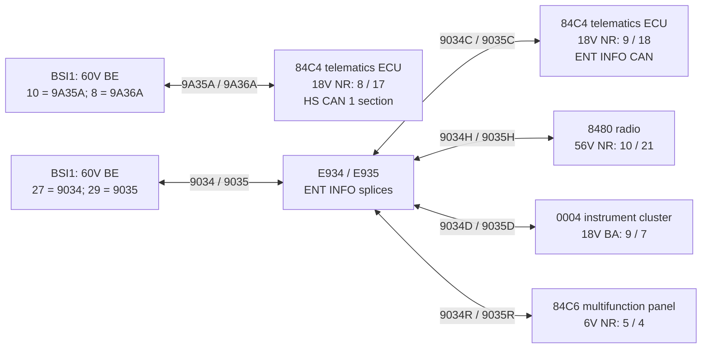
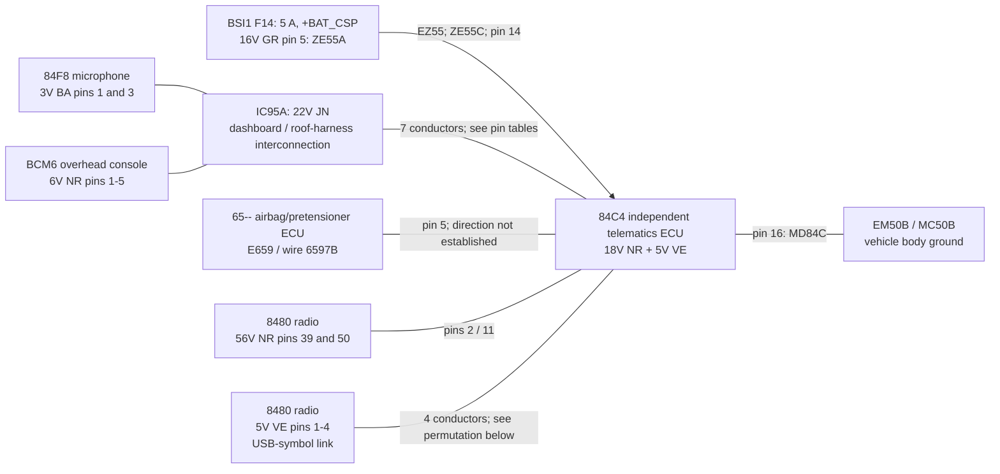

# Vehicle wiring and CAN access investigation

Vehicle focus: Opel Corsa-e, PSA P2JO / P2J0, 2019-2021 wiring collection. Reviewed: 2026-10-23.

This is a consolidated engineering note for the ESP32 gateway. It records the circuits shown in the supplied diagrams, separates them from assumptions, and identifies what must be checked on the actual car. It is not yet a vehicle-verified installation pinout.

## Main findings

- The independent telematics/eCall ECU is **84C4**. Its illustrated wiring has **two CAN pairs**, a supply, a ground, microphone and radio audio connections, a crash-related connection, connections to the overhead console, and a separate four-wire USB-symbol link to the radio.
- The drawings show **20 connected conductors across two connectors**: 16 populated positions of `18V NR` and four populated positions of `5V VE`. The remaining three positions are not drawn as connected; that does not prove they are unused on every vehicle.
- For capturing commands caused by Stellantis remote actions, the first candidate is **the BSI end of both telematics CAN pairs**, on the same `BSI1 / 60V BE` connector. This avoids assuming that OBD exposes the original telematics traffic.
- The roof SOS panel and the telematics ECU must be distinguished. The owner reports eCall in the headliner. The supplied general ECU location illustration places `84C4` near the dashboard, while the circuit explicitly connects it to overhead console `BCM6` and microphone `84F8`. Identify the actual ECU before ranking physical access.
- The eCall supply is fed through **BSI F14, 5 A, classified `+BAT_CSP`**. Its availability after vehicle sleep or power-management intervention has not been measured. It must not yet be treated as guaranteed always-on KL30.
- Public PSA CAN research already contains relevant remote-control definitions, but no tested Corsa-e cloud-independent command sequence has been established in this investigation.

Evidence notation: **[S]** visually checked in the supplied source; **[U]** owner-provided information; **[I]** engineering inference or proposal; **[M]** requires measurement on the vehicle. Source IDs are resolved at the end of this document.

## Reading the diagram notation

`18V NR` means an **18-way black connector**, not an 18-volt supply. Likewise, `5V VE` is a **5-way green connector**, not a 5 V power designation. Connector labels identify cavity count and housing colour; they do not identify a purchasable connector part number or establish which face is being viewed.

Wire colours below are the printed codes next to each conductor. The drawing's orange/yellow/green line colours are not a substitute for these wire-colour labels.

| Code | Meaning used here |
| --- | --- |
| `NR` | Black |
| `BE` | Blue |
| `BA` | White |
| `GR` | Grey |
| `VE` | Green |
| `MR` | Brown |
| `RS` | Pink |
| `VI` | Violet |
| `BG` | Beige |
| `RG` | Red |
| `OR` | Orange |
| `JN` | Yellow |
| `VJ` | Green/yellow |
| `ND` | Not specified in the drawing |

`E...` identifies an electrical splice/equipotential connection. `EM...` is a ground splice; `MC...` is a body earth point. A splice is not necessarily a conveniently accessible connector. `50 P/B`, `52 PLAF`, and `46 HAB` are harness labels, not connector cavity counts.

## eCall architecture, consolidated

### The two CAN paths

The supplied drawings place the `9A35A / 9A36A` connection in the **HS CAN 1** section, but draw it as a separate external run between BSI and 84C4. Other HS CAN 1 connections leave BSI on different pins. The drawings do not establish transparent forwarding between these BSI ports. Treat them as separate capture points until measurements prove otherwise. [S: S01, S05]

The `9034C / 9035C` pair is part of **ENT INFO CAN**. It branches through `E934 / E935` and is also available at the radio and instrument cluster. [S: S01, S04]



`TCU_A` and `TCU_B` are two interfaces of the same ECU. The diagram deliberately does not join the two CAN pairs together. It also does not assert which bus carries the remote climate/charging request.

### Other connections around the ECU



The audio and USB roles are inferred from symbols and connected components. The source does not provide the individual audio signal names, USB D+/D- assignments, or crash-line electrical specification. [S: S01, S02; I: signal interpretation]

## Every illustrated 84C4 conductor

### Main connector: 18V NR

All routes in this table were checked against both the wiring and principle sheets. Colour is given **at 84C4**; it can change across an interconnection. CAN polarity is deliberately not assigned from wire numbering alone. [S: S01, S02]

| 84C4 cavity | Wire | Colour | Destination / route | Interpretation |
| --- | --- | --- | --- | --- |
| 1 | `84H8` | RS | `IC95A / 17` -> roof-side `8487` RG -> `84F8 / 3V BA / 3` | Microphone conductor; polarity/function not specified. |
| 2 | `84H6B` | VI | `8480 / 56V NR / 39` | Radio audio link; exact signal not specified. |
| 3 | Not shown | - | No conductor drawn | Actual population/function must be checked. |
| 4 | `84B4` | VE | `IC95A / 9` -> roof-side `84B4` BG -> `BCM6 / 6V NR / 4` | Overhead console circuit; individual function not specified. |
| 5 | `6597B` | ND | `E659` -> `65--` airbag/pretensioner ECU; ECU cavity not given | Crash-related connection inferred; not a power or ground tap. |
| 6 | `84B3` | GR | `IC95A / 8` -> roof-side `84B3` RS -> `BCM6 / 6V NR / 1` | Overhead console circuit. |
| 7 | `84C0` | VI | `IC95A / 7` -> roof-side `84C0` BE -> `BCM6 / 6V NR / 5` | Overhead console circuit. |
| 8 | `9A35A` | VE | `BSI1 / 60V BE / 10` | CAN conductor, HS CAN 1 telematics run. |
| 9 | `9034C` | RS | `E934` -> `BSI1 / 60V BE / 27` (`9034` RS), also radio/cluster/panel branches | CAN conductor, ENT INFO. |
| 10 | `84H9` | BE | `IC95A / 18` -> roof-side `8488` RS -> `84F8 / 3V BA / 1` | Microphone conductor; polarity/function not specified. |
| 11 | `84H7B` | BG | `8480 / 56V NR / 50` | Radio audio link; exact signal not specified. |
| 12 | Not shown | - | No conductor drawn | Actual population/function must be checked. |
| 13 | `84B1` | BG | `IC95A / 6` -> roof-side `84B1` VI -> `BCM6 / 6V NR / 2` | Overhead console circuit. |
| 14 | `ZE55C` | RS | `EZ55` -> `ZE55A` BG -> `BSI1 / 16V GR / 5` -> BSI `F14`, 5 A | `+BAT_CSP` supply; not yet verified as continuous KL30. |
| 15 | `84B0` | RS | `IC95A / 5` -> roof-side `84B0` BA -> `BCM6 / 6V NR / 3` | Overhead console circuit. |
| 16 | `MD84C` | VJ | `EM50B` -> body earth `MC50B`; splice also serves cluster ground `MC004` | Ground / KL31 function. |
| 17 | `9A36A` | MR | `BSI1 / 60V BE / 8` | Other conductor of the HS CAN 1 telematics pair. |
| 18 | `9035C` | VI | `E935` -> `BSI1 / 60V BE / 29` (`9035` VI), also radio/cluster/panel branches | Other conductor of the ENT INFO pair. |

Pins `8 / 17` form one CAN pair; pins `9 / 18` form the other. They are not four interchangeable CAN wires.

### Secondary connector: 5V VE

The principle sheet marks a USB symbol at this interface. Preserve the actual cavity permutation rather than assuming equal pin numbers at both ends. [S: S01, S02]

| 84C4 cavity | Wire | Colour | 8480 radio destination |
| --- | --- | --- | --- |
| 1 | `84V0A` | MR | `5V VE / 2` |
| 2 | `84V2A` | BE | `5V VE / 3` |
| 3 | `84V1A` | VE | `5V VE / 1` |
| 4 | `84V3A` | OR | `5V VE / 4` |
| 5 | Not shown | - | No conductor drawn; inspect actual connector. |

This is not an additional CAN pair or a confirmed spare ESP32 power source. Do not infer USB electrical pin functions from the colour codes. RF antenna connectors, an internal backup battery, shielding/drain details, and other hardware features are not established by these sheets; the table covers the drawn harness circuits.

### Roof interconnection IC95A: useful exclusion

The seven eCall-related circuits shown through `IC95A / 22V JN` are:

| IC95A cavity | Roof endpoint | 84C4 18V NR endpoint |
| --- | --- | --- |
| 5 | `BCM6 / 3`: `84B0` BA | `15`: `84B0` RS |
| 6 | `BCM6 / 2`: `84B1` VI | `13`: `84B1` BG |
| 7 | `BCM6 / 5`: `84C0` BE | `7`: `84C0` VI |
| 8 | `BCM6 / 1`: `84B3` RS | `6`: `84B3` GR |
| 9 | `BCM6 / 4`: `84B4` BG | `4`: `84B4` VE |
| 17 | `84F8 / 3`: `8487` RG | `1`: `84H8` RS |
| 18 | `84F8 / 1`: `8488` RS | `10`: `84H9` BE |

**Neither CAN pair is shown through these IC95A circuits.** Tapping the visible roof SOS/microphone wiring therefore does not, by itself, give access to the telematics CAN connection. [S: S01, S02]

## Where to connect the gateway

Ranked for this project's need to observe remote commands; installation effort remains provisional until trim access and connector availability are checked.

| Priority | Candidate | Signals available | Assessment |
| --- | --- | --- | --- |
| 1 | **BSI1, 60V BE** | Telematics pair: `10 / 8`; ENT INFO: `27 / 29` | Best first investigation point: both eCall CAN pairs on one housing. A suitable breakout could preserve every original circuit. Confirm actual connector identity, cavity orientation and access. [S01, S04, S05; I: ranking] |
| 2 | **Actual 84C4 ECU, 18V NR** | Both CAN pairs `8 / 17`, `9 / 18`; supply `14`; ground `16` | Electrically compact, but location/access is unresolved. If actually in the headliner, route effort may make it less attractive; if the ECU is behind the dashboard, reassess. Pass through all original circuits. [S01; U: roof location] |
| 3 | **8480 radio, 56V NR** | ENT INFO `10 / 21`; `BE29D` supply at `11`; ground `22` | Potentially convenient for infotainment-bus capture and packaging. Does not expose the separate `9A35A / 9A36A` eCall pair. Supply is also `+BAT_CSP` via F29, 20 A. [S01, S04, S12] |
| 4 | **0004 instrument cluster, 18V BA** | ENT INFO `9 / 7`; supply `1`; ground `8` | Another access point to the same shared ENT INFO network; no extra telematics CAN coverage. Physical effort to be checked. [S01, S04] |
| 5 | **BSI1, 60V NR** | Main HS CAN 1 `5 / 3`; HS CAN 2 `46 / 44`; diagnostic pairs on other cavities | Useful second-stage observation of BSI forwarding and vehicle response. Not an electrical substitute for the separate telematics run. [S05, S06, S11] |
| Excluded as primary command tap | **C001 diagnostic socket / OBD** | Diagnostic wiring and a documented battery feed | Owner identifies OBD as isolated. The diagrams also give it distinct BSI pins/wire numbers. Keep it as a diagnostic/power reference, not proof of access to original TCU commands. [U; S11] |

For the first capture setup, prefer **parallel, high-impedance observation with the OEM eCall ECU connected**, not an ESP32 inserted as a mandatory forwarding bridge. Preserve the original bus termination and keep added stubs short. An inline directional bridge would be a separate, later design decision. [I; E03]

Two simultaneous CAN captures require **two independent CAN controller/transceiver channels**. Two transceivers attached to one controller do not provide simultaneous capture of both networks. The exact ESP32 variant/controller arrangement has not been selected. Espressif documents the external transceiver requirement and listen-only operation. [E02]

## KL30, KL31, and parked operation

KL30 denotes battery positive independent of the ignition switch; KL31 denotes the ground/negative return. The requested ground designation is therefore **KL31**. These terminal functions are distinct from connector cavity numbers. [E01]

| Candidate | Route shown | What is established / what remains open |
| --- | --- | --- |
| eCall supply | `BSI F14 / 5 A` -> `16V GR / 5`, `ZE55A` -> `EZ55` -> `ZE55C` -> `84C4 / 14` | Fuse table classifies it `+BAT_CSP`, shared with alarm/hands-free equipment. Sleep-time availability and spare load capacity are unmeasured. Do not assume unconditional KL30. [S01, S02, S12] |
| Radio supply | `BSI F29 / 20 A` -> `16V GR / 9`, `BE29D` -> `8480 / 56V NR / 11` | Also classified `+BAT_CSP`; same availability qualification applies. [S01, S12] |
| Known battery-feed reference | `BSI F12 / 7.5 A` -> `16V BE / 2`, `1477A` -> `C001 / 16V NR / 16` | Labelled `+Batterie` in the fuse table. Useful reference for a true battery-fed supply; a new permanent installation should have its own appropriately designed/fused branch rather than an assumed spare capacity in this shared circuit. [S11, S12; I: installation proposal] |
| eCall ground | `84C4 / 18V NR / 16`, `MD84C` VJ -> `EM50B` -> `MC50B` | Ground route is explicit. Exact physical stud/access must be checked. [S01, S02, S14] |
| BSI-area ground | `BSI1 / 16V BE / 9`, `MCBSC` VJ -> `EM37B` -> `MC37B` | Alternative body-ground reference near the BSI harness. General earth drawing shows the MC37 area but does not resolve every suffix/fastener. [S01, S11, S14] |
| OBD ground reference | `C001 / 4`, `MCC0B` -> `EM37B`; `C001 / 5`, `MCC0A` -> `EM37A` | Both routes are drawn; connector numbers are not universal ground terminal names. [S11] |

The component-list description of `EZ55` refers to a CAN-related supply/fuse number that does not agree cleanly with the illustrated F14 circuit. Use the traced wiring plus the explicit fuse allocation, and confirm the vehicle. A `+CAN` **supply** entry is not a CAN-H/CAN-L data conductor. [S03, S12]

The gateway supply needs a protected automotive 12 V input stage, a suitable regulator, its own branch protection, and a low-battery strategy. A permanent Wi-Fi receiver and vehicle sleep must be designed together: ESP32 deep sleep does not provide normal continuous Wi-Fi command reception. Determine whether continuous reception or periodic connection windows are required before choosing the parked power budget. [I; E04]

## CAN availability across the wiring collection

This overview covers every CAN interconnection category in the supplied collection plus the diagnostic and trailer branches. It is not a claim that all options or alternative diagrams are fitted simultaneously.

| Network / section | Illustrated access points and components | Important distinction |
| --- | --- | --- |
| ENT INFO, `9034 / 9035` | BSI `60V BE / 27,29`; BSI `60V JN / 34,36`; `84C4` `18V NR / 9,18`; `8480` `56V NR / 10,21`; cluster `0004` `18V BA / 9,7`; panel `84C6` `6V NR / 5,4`; hands-free `8240` `26V BE / 21,22` through `IC91B / 14,15`; parking ECU `7500` `26V JN / 26,25`. | BSI's two external runs are shown separately; E934/E935 join the dashboard branches. Other equipment variants place 7500 on HS CAN 1 instead. [S04] |
| HS CAN 1, `9A35 / 9A36` | BSI `60V NR / 5,3` on the main external branch; separate eCall run BSI `60V BE / 10,8` -> 84C4 `8,17`; drive supervisor `1775` `70V NR / 53,37`; selector `1603` `6V BE / 1,4`; headlamp ECU `6606` `18V NR / 7,16`; steering ECU `7126` `3V GR / 2,3`; parking ECU `7500` `18V NR / 8,9`; ESP `7800` `46V NR / 4,18` and `5,19`; camera `7573` `12V BE / 8,9` in one variant. | The eCall, camera, diagnostic and main vehicle connections leave different BSI pins. Shared section title is not proof of an uninterrupted wire-level bus. [S05] |
| HS CAN 2, `9A37 / 9A38` | BSI `60V NR / 46,44`; supervisor `1775` `70V NR / 48,32`; ESP `7800` `46V NR / 11,25`; pedestrian sound unit `2524` `4V NR / 3,2` via `IC02A / 4,8`; camera `7573` `12V BE / 4,5` or radar `7571` `6V NR / 5,4` depending on variant. | Alternative sheets also show loops `9091 / 9092` on BSI `35V NR`. Do not merge alternatives into one vehicle pinout. [S06] |
| Passenger compartment, `9038 / 9039` | BSI `60V BE / 16,18`; BSI `60V MR / 23,25`; steering controls `CV00` `18V NR / 12,13`; climate ECU `8080` `6V NR / 4,5`; steering lock `AE00` `6V BA / 4,5`; airbag ECU `6570` `30V NR / 30,29` via IC91B; driver's door control `6036` `20V JN / 2,9` via ICV4B. Trailer ECU `BSG1` has `16V BE / 3,5` via BSI `60V JN / 47,49`. | Climate control hardware is on a different network from ENT INFO. BSI may translate a higher-level request; the remote request need not be a direct compressor command. [S07, S19] |
| eCAN, `93P5 / 93P6` | Drive supervisor `1775` on `120V NR / 36,57` and another run on `70V NR / 35,51`; traction-battery interface `1778` `27V NR / 2,1`; traction motor controller `1917` `10V NR / 2,7`; park actuator `70B4` `4V NR / 2,3`; charger/DC-DC `1708` `32V NR / E2,E1`. | Contains separate illustrated runs and EV-specific hardware. Not the first physical tap for telematics command discovery. The `93P5B / 93P6B` battery-interface conductors must not be confused with similarly printed `9A35A / 9A36A` at 84C4. [S08, S20] |
| ADAS, `9A33 / 9A34` | BSI `60V NR / 28,26` -> radar `7571` `6V NR / 2,1` via ICY4; BSI `35V NR / 6,8` -> camera `7573` `12V BE / 5,4`. | Alternative equipment layouts reuse some BSI/camera positions seen in other sheets. Match wire codes and equipment before using a cavity. [S09] |
| Headlamp CAN, `9A43 / 9A44` | Headlamp-control ECU `6606` `18V NR / 15,6`; left lamp `2610` and right lamp `2615`, each `10V NR / 2,7`, through E261L/E261H. | Local lighting branch, not an alternative to the telematics bus. [S10] |
| Diagnostic wiring | C001 `6,14`: `9064 / 9065` -> BSI `60V NR / 15,13`; C001 `3,8`: `9028 / 9029` -> BSI `60V NR / 8,10`. | Distinct from both telematics wire pairs. No assumption of unfiltered forwarding. [S11] |
| DEPOLLUTION, `9079 / 9080` | `1320`, `12B1`, `13C1`, `13D1`. | Diesel engine / urea / NOx equipment in this collection; exclude from the Corsa-e target unless independently justified. [S17] |

The dedicated LIN interconnection section is a separate network type. Wire names alone, especially numbers beginning with `9`, do not establish that a circuit is CAN.

### eCAN, powertrain CAN and the diagnostic naming

For the electric battery/motor/charger-side network, the service-manual name is **eCAN**, pair **93P5 / 93P6**. S08 shows a battery/motor/park branch at supervisor 1775 `120V NR / 36,57`, and a separately drawn charger run at `70V NR / 35,51`. S20 also shows 1775 connected to HS CAN1 and HS CAN2. This establishes the supervisor's presence on several external networks, without establishing transparent forwarding or an electrical connection between its ports. The eCall ECU is shown on its HS CAN1 run and ENT INFO, not directly on the battery eCAN pair. [S01, S05, S06, S08, S20]

The 2026-10-23 comparison with the existing Android dashboard found that PSA-RE's `BMU_CTE1` diagnostic model matches **6B4 / 694** and the lengths/scales of all eight current DID reads, including **D865 = raw/64 kWh**. PSA-RE calls that diagnostic route `HS.IS`; its inherited frame collection also uses `HS.HYB`. Neither label is a measured one-to-one mapping to the physical eCAN pair in these drawings. Raw CAN access can carry periodic broadcasts and ISO-TP diagnostics; the UDS match alone does not locate the broadcast traffic or a telematics command.

The English cross-check and full DID inventory are maintained in the sibling Android project: `C:/work/bev/android_dash/docs/PSA_RE_UDS_CANDIDATES.md` and `PSA_RE_UDS_CATALOG.md`. The core local battery broadcast frames have no matching e-CMP definition in this PSA-RE snapshot. The comparison records unresolved differences in `0x552` mileage scaling and `0x594` insulation-flag layout; the existing gateway DBC was not changed.

## Existing projects and remote-command research

### What was actually found

The public [PSA-RE repository](https://github.com/prototux/PSA-RE) contains CAN definitions, node descriptions and diagnostics. The snapshot inspected here is commit [`67f7581e7622410efdbb29c7eda3b86982b9b450`](https://github.com/prototux/PSA-RE/tree/67f7581e7622410efdbb29c7eda3b86982b9b450), dated 2026-10-10. Its [P2 vehicle description](https://github.com/prototux/PSA-RE/blob/67f7581e7622410efdbb29c7eda3b86982b9b450/cars/P2.yml) explicitly includes Corsa-e, with an `AEE2010.electric` variant.

The following are **capture/decoding leads**, not verified commands for this vehicle. Paths are under `buses/AEE2010.full/LS.INFO-DIV/` in that snapshot.

| ID | File / description in the database | Research use |
| --- | --- | --- |
| `0x31B` | [31B.yml](https://github.com/prototux/PSA-RE/blob/67f7581e7622410efdbb29c7eda3b86982b9b450/buses/AEE2010.full/LS.INFO-DIV/31B.yml): remote climate scheduling, including an immediate-request flag. | Compare against observed climate start/stop/schedule actions. |
| `0x11B` | [11B.yml](https://github.com/prototux/PSA-RE/blob/67f7581e7622410efdbb29c7eda3b86982b9b450/buses/AEE2010.full/LS.INFO-DIV/11B.yml): second portion of remote climate schedule data. | Companion scheduling candidate; top-level name conflicts with the described contents. |
| `0x35B` | [35B.yml](https://github.com/prototux/PSA-RE/blob/67f7581e7622410efdbb29c7eda3b86982b9b450/buses/AEE2010.full/LS.INFO-DIV/35B.yml): remote charging schedule/type request. | Compare immediate and delayed charging actions; not proof that arbitrary charge limits are supported. |
| `0x43C` | [43C.yml](https://github.com/prototux/PSA-RE/blob/67f7581e7622410efdbb29c7eda3b86982b9b450/buses/AEE2010.full/LS.INFO-DIV/43C.yml): MDS wake-up indication. | Check timing around a real remote wake-up; an indication may not itself wake a sleeping vehicle. |
| `0x53C` | [53C.yml](https://github.com/prototux/PSA-RE/blob/67f7581e7622410efdbb29c7eda3b86982b9b450/buses/AEE2010.full/LS.INFO-DIV/53C.yml): MDS supervision. | Identify normal network-management behaviour around commands. |
| `0x394` | [394.yml](https://github.com/prototux/PSA-RE/blob/67f7581e7622410efdbb29c7eda3b86982b9b450/buses/AEE2010.full/LS.INFO-DIV/394.yml): description includes a charging-data request, but the top-level name refers to battery power data. | Explicit example of database inconsistency; validate against captures before interpretation. |

The database's node mapping also changes: `MDS` is on `LS.INFO-DIV` in [AEE2010.ev](https://github.com/prototux/PSA-RE/blob/67f7581e7622410efdbb29c7eda3b86982b9b450/nodes/AEE2010.ev.yml), while [AEE2010.electric](https://github.com/prototux/PSA-RE/blob/67f7581e7622410efdbb29c7eda3b86982b9b450/nodes/AEE2010.electric.yml) lists it on `HS.HS1`. The candidate frame files above are inherited from a broader variant, not a Corsa-e validation report. Do not mechanically map repository bus names onto the two physical 84C4 pairs or assume a sender alias proves ECU identity.

Other useful references:

- [flobz/psa_car_controller](https://github.com/flobz/psa_car_controller) implements control through the connected-car API. Useful for generating a known remote action during capture, but it remains a cloud client and does not supply the local CAN replacement.
- [EsaHub/EscoEvObdScanner](https://github.com/EsaHub/EscoEvObdScanner) provides eCMP diagnostic/telemetry research. Its stated scope is read-only OBD diagnostics, not raw remote-command replacement.
- The [Open Vehicles e-208 investigation](https://api.openvehicles.com/node/2505) records early captures and two diagnostic CAN connections. It is not evidence of a completed eCMP remote-climate implementation.
- [ludwig-v/arduino-psa-comfort-can-adapter](https://github.com/ludwig-v/arduino-psa-comfort-can-adapter) is relevant background for PSA comfort/infotainment messages and retrofit behaviour, not a proven eCMP cloud-independent remote controller.

No complete, tested Corsa-e Wi-Fi-to-CAN replacement for these remote features was identified in this search. That is a bounded search result, not a claim that nobody has implemented one. No external code or database definitions have been copied into this BSD-licensed repository; the links are research references.

### Capture plan for cloud-originated actions

The cloud does not necessarily send a CAN frame unchanged. The working model is: remote request -> telematics ECU -> vehicle-side request and network-management sequence -> BSI/vehicle response. Determine that sequence from observation rather than assuming one fixed CAN payload. [I]

1. Confirm actual ECU identity/location, the two wire pairs, connector orientation, CAN-H/L polarity, bitrate, frame format, and sleep behaviour. The supplied electrical drawings do not specify all of these.
2. Observe both 84C4 pairs simultaneously at the BSI end with synchronised timestamps and listen-only interfaces. Keep all identifiers initially; a filter based only on the public candidates could hide the actual request.
3. Record a no-command baseline and separate, timestamped trials of climate start, climate stop, charging-mode changes, and status refresh. Record cloud acceptance and the actual vehicle outcome separately.
4. Repeat in awake and fully sleeping states, and with charging connected/disconnected as applicable. Keep phone/key proximity and door activity controlled so their wake-ups do not masquerade as telematics commands.
5. Separate command candidates from wake-up traffic, periodic supervision, acknowledgements and downstream state reports. Plain CAN captures do not intrinsically identify the transmitting ECU or prove causal direction.
6. Compare payload changes, repeated requests, counters/checksums, diagnostic/ISO-TP exchanges, timing and possible authentication. Public definitions are hypotheses to test against the captures.
7. Select the minimum observed command sequence only after reproducible validation. Establish coexistence with the OEM telematics ECU and its sleep management before implementing active transmission.

## Decisions still requiring vehicle evidence

| Question | Current position |
| --- | --- |
| Where is the actual 84C4 ECU? | Owner reports roof eCall; source locator depicts dashboard. Distinguish ECU from roof console, then confirm hardware label and connectors. |
| Which pair carries the original remote request? | Unknown. Capture both `9A35A / 9A36A` and `9034C / 9035C`. |
| Are telematics, main HS CAN 1 and OBD transparently connected? | Not established by section naming; OBD is excluded as the primary tap based on the owner's information. |
| CAN-H/L and bitrate at 84C4? | Not assigned from wire codes; measure or obtain an explicit matching connector/signal specification. |
| Is eCall F14 power present throughout parking? | Unknown. Measure voltage through full sleep and power-management transitions. |
| Is enough current available for the gateway on that branch? | Unknown; fuse rating is not spare capacity. |
| Connector housings/terminals and cavity viewing direction? | Not supplied. Identify before ordering or building a breakout. |
| Are schedule, start/stop, wake and status independently reproducible? | No captures yet; no command implementation claimed. |

## Source register

Local source root:

```text
C:\work\bev\service manual\Opel PSA e-Corsa eP2JO 2019-2021 Wiring Diagrams\EWD
```

Paths below are relative to that root. `p.` is the PDF page number. Several sheets carry a VIN-specific selection and OPR 16098, with a printed date of 07/11/2021. This collection includes equipment alternatives and at least one diesel-only sheet; its folder title does not make every diagram applicable to the owner's car.

| ID | Source path / locator |
| --- | --- |
| S01 | `Comfort and Convinience/Audio_Navigation_Telematics_Telephone_Multimedia/Independent Telematic Unit/wiring.pdf`, p.1, **D3CZV9GG**. Main source for every illustrated 84C4 conductor. |
| S02 | Same directory, `principle.pdf`, p.1, **D3CZV9GR**. Cross-check of functions, power, grounds and IC95A routing. |
| S03 | Same directory, `list of components.pdf`, p.1. ECU/component descriptions; contains inconsistent supply-splice wording. |
| S04 | `General Points/Interconnections/ENT INFO CAN Interconnection/wiring.pdf`, p.1, **D3CZV7AG**; `principle.pdf`, pp.1-2, **D3CZV7AR**. |
| S05 | `General Points/Interconnections/HS CAN 1 Multiplexed Network Interconnection/wiring 1.pdf`, p.1, **D3CZV75G**; `principle 1.pdf`, pp.1-2, **D3CZV75R**; `wiring 2.pdf`, p.1, **D3CZV74G**; `principle 2.pdf`, pp.1-2, **D3CZV74R**. |
| S06 | `General Points/Interconnections/HS CAN 2 Multiplexed Network Interconnection/wiring 1.pdf`, p.1, **D3CZV77G**; `wiring 2.pdf`, p.1, **D3CZV78G**; `wiring 3.pdf`, p.1, **D3CZV76G**; associated principle sheets. |
| S07 | `General Points/Interconnections/Multiplexed Passenger Compartment CAN Interconnection/wiring.pdf`, p.1, **D3CZV7DG**; `principle.pdf`, pp.1-2, **D3CZV7DR**. |
| S08 | `General Points/Interconnections/ECAN Network Interconnection/wiring.pdf`, p.1, **D3CZV7CG**; `principle.pdf`, pp.1-2, **D3CZV7CR**. |
| S09 | `General Points/Interconnections/ADAS CAN Interconnection/wiring.pdf`, p.1, **D3CZV7BG**; `principle.pdf`, p.1, **D3CZV7BR**. |
| S10 | `General Points/Interconnections/CAN Network Interconnection/wiring.pdf`, p.1, **D3CZV79G**; `principle.pdf`, p.1, **D3CZV79R**; component list. |
| S11 | `General Points/Sockets_Terminals_Connectors/Diagnostic Socket/wiring.pdf`, p.1, **D3CZV7FG**; `principle.pdf`, pp.1-2, **D3CZV7FR**. |
| S12 | `General Points/Matching of Fuses/Allocation of BSI1 Fuses.pdf`, pp.1-3; supply diagram **d3ap99fp**, fuse layout **d3ap99gp**, and fuse allocation tables. |
| S13 | `General Points/Installations/General Layout of ECUs.pdf`, p.1, **d3aq096p**. Schematic location only; not a trim-removal guide. |
| S14 | `General Points/Installations/General Location of Earths.pdf`, p.1, **d3ap98np**. |
| S15 | `General Points/Installations/General Location of Interconnections.pdf`, p.1, **d3ap98qp**. |
| S16 | `General Points/Installations/Harness Installation Diagrams.pdf`, p.1, **d3aq097p**. |
| S17 | `General Points/Interconnections/_xxx_DEPOL CAN Interconnection/wiring.pdf`, p.1, **D3CZUNDG**; `principle.pdf`, p.1, **D3CZUNDR**; component list. |
| S18 | `Driver Information/Display Systems/Multifunction Screen/wiring.pdf`, p.1, **D3CZV8WG**. Cross-check of radio and panel branches. |
| S19 | `General Points/Sockets_Terminals_Connectors/Caravan Socket/wiring.pdf`, p.1, **D3CZUNGG**. Trailer branch. |
| S20 | `Power Unit/Engine/100 KW 260 NM Electric Standalone/Traction Battery Management/principle 1.pdf`, p.1, **D3CZV7PR**. Additional 1778/1775 wiring. |

External engineering references:

- **E01:** [HELLA terminal designations](https://www.hella.com/partnerworld/assets/documents/1694_SA_Brochure_HELLA_EN.pdf), terminal-designation section: KL30/KL31 functions.
- **E02:** [Espressif TWAI documentation](https://docs.espressif.com/projects/esp-idf/en/stable/esp32/api-reference/peripherals/twai.html): controller/transceiver interface and listen-only operation.
- **E03:** [Analog Devices AN-1123 CAN Implementation Guide](https://www.analog.com/en/resources/app-notes/an-1123.html): physical topology, short stubs and bus termination.
- **E04:** [Espressif sleep-mode documentation](https://docs.espressif.com/projects/esp-idf/en/stable/esp32/api-reference/system/sleep_modes.html): Wi-Fi connectivity and deep-sleep limitations.

All 164 PDFs were inventoried and text-indexed. The network interconnection diagrams, independent telematics sheets, relevant functional sheets, fuse allocation and location drawings were then reviewed visually, with enlarged details for critical 84C4 pins and supply routing. Indexing is not a claim that every individual accessory circuit was audited or that any pin has been measured on the car.
